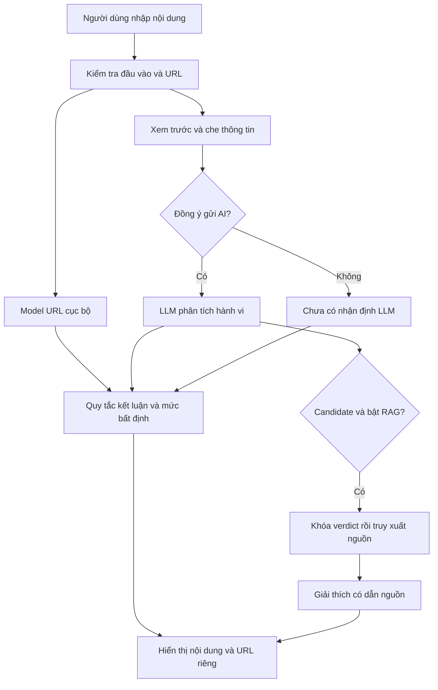

# Kiến trúc

## Phân chia trách nhiệm

| Package | Trách nhiệm |
|---|---|
| `app/api` | Route HTTP, lifecycle, lựa chọn dịch vụ theo profile |
| `app/core` | Đường dẫn gốc, cấu hình môi trường, che thông tin cá nhân |
| `app/domain` | Kiểu dữ liệu, kiểm bằng chứng và quy tắc kết luận |
| `app/services` | Điều phối luồng phân tích |
| `app/services/llm` | Transport API, prompt và parser phiên bản hóa |
| `app/services/url` | Trích xuất, chuẩn hóa, suy luận model và policy URL |
| `app/services/rag` | Encoder, truy xuất, lựa chọn nguồn và lời giải thích |
| `app/static` | Giao diện chạy cùng origin với API |

Các factory cho phép đưa transport/model/retriever giả vào kiểm thử offline. Mã phục vụ ứng dụng không import runner đánh giá khi khởi động; lệnh export model chỉ import phần huấn luyện khi được gọi rõ ràng.

## Các profile

| `PHISHLENS_PROFILE` | ASGI | Cấu hình |
|---|---|---|
| `stable` — mặc định | `app.main:app` | v4, XGBoost, MessageService |
| `quality-v4` | `app.main:app` | Alias tương thích cho v4 |
| `candidate` | `app.api.interaction:app` | v6.1, URL ký tự, intake nâng cao và cấu trúc tương tác |
| `candidate-v5` | `app.api.candidate:app` | v5, phục vụ đối chứng |
| `legacy` | `app.api.legacy:app` | v3, phục vụ đối chứng |

`app/main.py` là entry point công khai của bản ổn định. Các module `policy_v5.py`, `policy_v6.py`, `compact.py` trong `services/llm` giữ những hợp đồng prompt/parser cần cho đối chứng; không gộp chúng thành một prompt rồi ghi đè lịch sử. Profile candidate vẫn là thử nghiệm.

## Luồng xử lý

Bản stable có thể đưa nguồn RAG vào lời gọi phân loại khi bật RAG. Candidate v5/v6.1 khóa verdict trước khi truy xuất và giải thích; phần nguồn không được thay kết luận. Các arm RAG trước/sau phân loại là những thí nghiệm khác nhau.

## Kết luận và rủi ro URL

Kết quả hành vi trong thông điệp và điểm URL được giữ riêng. URL điểm thấp không xác minh nội dung an toàn; cảnh báo chung từ tài liệu không xác minh một miền lừa đảo. Nội dung không có URL vẫn được LLM đánh giá. Thiếu căn cứ, lỗi parse hoặc dịch vụ lỗi được thể hiện rõ, không chuyển thành LOW.

Model XGBoost có mốc thấp `0,113843` và HIGH `0,473643` (hiển thị làm tròn). Bản stable đổi dải WARNING của model thành UNKNOWN; các mốc đầy đủ lấy từ gói model. Model ký tự dùng mốc thấp `0,5`, HIGH lấy từ export validation lịch sử. Không diễn giải các score này thành xác suất lừa đảo đã hiệu chỉnh. [Đánh đổi và giới hạn](results.md#url).

Candidate kiểm tra authority thống nhất bằng UTS #46 nontransitional/STD3. Với URL che dấu, giữ chuỗi gốc và danh sách phép đổi; URL khôi phục chỉ được chấm cục bộ và không tự thêm vào payload đã được người dùng duyệt. Intake không tải trang, phân giải DNS hoặc khẳng định URL đã được xác minh.

## Nguồn dẫn và dữ liệu người dùng

- LLM chỉ nhận nội dung đã xác nhận; URL/score đã bị xóa khỏi bản duyệt không được đưa trở lại qua metadata.
- API key trong `.env` không trả về giao diện. Key nhập trên giao diện chỉ dùng trong phiên.
- Nguồn dẫn phải thuộc tập truy xuất và quote phải có trong tóm lược của nguồn. Candidate `span_selection` chỉ cho chọn cặp đoạn có sẵn.
- Quote tồn tại và JSON đúng schema chưa chứng minh hỗ trợ ngữ nghĩa. Cờ `interaction_semantics_verified=false` giữ giới hạn của phần suy diễn vai trò.
- Prompt injection trong nội dung/tài liệu được xử lý như dữ liệu không tin cậy; LLM không có công cụ mở URL/thực thi. Chưa có bằng chứng chống injection đủ rộng để công bố an toàn.

Candidate mặc định dùng giải thích `free_text`; đặt `PHISHLENS_CANDIDATE_RAG_MODE=span_selection` khi cần thử hợp đồng lựa chọn đoạn. Mode, prompt, token và corpus/index phải được khóa trong mỗi thí nghiệm, không suy kết quả của một cấu hình sang cấu hình khác.
