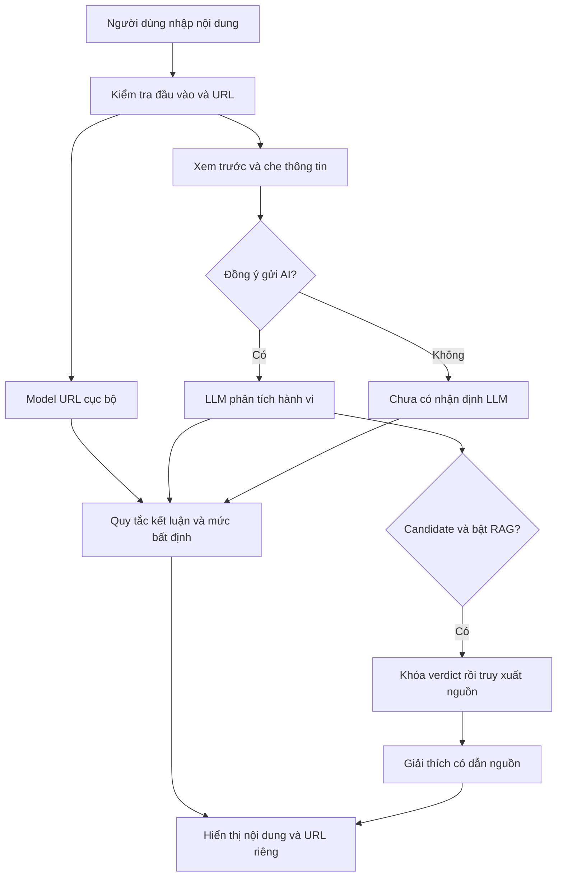

# Kiến trúc

## Lớp ứng dụng: khách và tài khoản — 24/11

`run.py` mặc định dùng factory `app.api.workspace:create_app`, bọc runtime phân tích theo `PHISHLENS_PROFILE`. Lớp này thêm tài khoản, dashboard, lịch sử và quản trị, giữ nguyên factory `app.api.runtime` cho đánh giá không có tài khoản. `PHISHLENS_ACCOUNTS=0` chỉ chọn factory nghiên cứu cũ. Mã lưu trữ ở `app/services/workspace.py`; các trang đăng nhập/portal và client dùng các asset `workspace.*`, `account.*`, `portal.*`.

SQLite dùng schema có phiên bản, foreign key, WAL và transaction khi tạo tài khoản/đếm quota. Lưu hash scrypt có salt riêng (`N=2^17, r=8, p=1`) bằng `hashlib`, đối chiếu constant-time; cấu hình theo [OWASP Password Storage](https://cheatsheetseries.owasp.org/cheatsheets/Password_Storage_Cheat_Sheet.html). Session là token ngẫu nhiên, database chỉ giữ SHA-256 của token, có hạn 12 giờ. Cookie HttpOnly/SameSite Strict, CSRF token và kiểm Origin áp dụng cho request ghi; `Secure` được bật khi người vận hành cấu hình HTTPS. Tham khảo [OWASP Session Management](https://cheatsheetseries.owasp.org/cheatsheets/Session_Management_Cheat_Sheet.html). Không gửi session hoặc mật khẩu cho provider.

Mọi truy vấn lịch sử đều có `user_id` từ session; đọc/sửa/xóa mã của người khác trả 404. Quyền admin được kiểm ở server, không dựa vào việc ẩn nút. Tài khoản đầu tiên là admin; tự hạ quyền/khóa tài khoản hiện tại bị từ chối. Đổi mật khẩu hoặc khóa người dùng xóa các phiên cũ. Khôi phục mật khẩu là lệnh nhập ẩn trên máy vận hành, chưa có email reset.

Lịch sử mặc định chỉ lưu metadata của lượt kiểm tra. Snapshot nội dung phải được chọn riêng, được che lại và bỏ kết nối/key/telemetry; không khôi phục URL đã xóa khỏi bản gửi. Database và backup bị Git ignore. Quota AI tính request phân tích được nhận, giới hạn 100/24 giờ/tài khoản theo cấu hình; một request có thể gọi classifier/giải thích/verifier trong cùng ngân sách chờ. Lớp này không sửa risk, nhãn tham chiếu hoặc RAG corpus. Đây là sản phẩm chạy localhost/demo, chưa thiết kế xác minh email, MFA hoặc triển khai công khai nhiều worker.

## Phân chia trách nhiệm

Extension 0.5 dùng Side Panel API (Chrome 116+), theme cục bộ, bảng Kiểm tra/Trợ lý/Kết nối, ba chế độ đầu vào và khoanh vùng trực tiếp trên trang. `region.js` được inject bằng `scripting`/`activeTab` sau thao tác người dùng, tạo overlay trong shadow DOM. Worker kiểm nonce một lần, tab/document/frame, hạn 120 giây và viewport trước/sau screenshot; cắt bằng OffscreenCanvas trước khi chuyển crop vào bảng. Bảng tự OCR, preview chữ và chờ consent. Ảnh toàn viewport không lưu hoặc gửi backend; crop chỉ chờ trong RAM worker tối đa 30 giây, không đưa vào storage. Cuộn/resize trong khi chọn làm hủy; Esc hủy. `images.js` vẫn giữ tải/drop/paste/crop ảnh riêng, đọc chữ khi bấm. Không fetch ảnh từ URL trang.

Nút nổi và tự kiểm URL là hai tùy chọn riêng, mặc định tắt. Chrome hỏi quyền host `<all_urls>` khi bật; `floating.js` đăng ký động chỉ HTTP/HTTPS, có menu, kéo/bám mép, tạm nghỉ và ẩn hostname. Helper không đọc DOM hoặc token. `assistant.js` xử lý sự kiện tab/URL (kể cả SPA), chấm chuỗi URL qua API localhost với AI/RAG/consent/history đều tắt. Bỏ qua incognito và origin ứng dụng; không chặn điều hướng. Mỗi tab có cache score tối đa 5 phút; cache lỗi 15 giây; tối đa hai request, timeout 12 giây. Cache phiên chỉ giữ SHA-256 URL/thời điểm/status/score, danh sách ẩn giữ hash hostname tối đa 100. URL đầy đủ chỉ được gửi localhost khi opt-in, không gửi provider. Tắt/tạm nghỉ/ẩn/đổi kết nối hủy tác vụ và không áp dụng phản hồi muộn; kiểm URL vẫn dùng quota/giới hạn của API ứng dụng.

`storage.local` và `storage.session` đặt `TRUSTED_CONTEXTS` để helper không đọc token. Worker MV3 chạy theo sự kiện, không heartbeat; quyền `alarms` chỉ dùng báo thức một lần kết thúc tạm nghỉ một giờ. Không giữ CPU chạy liên tục. Backend cục bộ vẫn phải chạy. Thu hồi quyền gỡ helper và tắt tự kiểm. [Quyền và sử dụng](../extensions/chromium/README.md).

`/api/extension/image-text` là POST nhị phân riêng với bearer; adapter kiểm auth/origin/MIME, đọc stream tối đa 5 MiB, rate-limit 30/giờ/tài khoản, ngoài JSON middleware lõi vẫn giữ cap 64 KiB. `app/services/image_text.py` kiểm decoder/format/kích thước tối đa 12 MP, chuẩn hóa EXIF/alpha trong bộ nhớ rồi đưa PNG qua stdin Tesseract vie+eng, timeout 20 giây, tối đa hai tác vụ. Không lưu ảnh/file, không gọi provider, không tạo history. Người dùng sửa chữ rồi dùng pipeline preview/consent/phân tích văn bản hiện hữu. Đây là OCR, chưa thêm model suy luận hình ảnh hoặc QR. `requirements/ocr.txt` tùy chọn; URL/văn bản không phụ thuộc binary OCR. Xem [OCR](guides/OCR.md).

`extensions/chromium/` là client Manifest V3 cục bộ. Từ 0.5, bảng tự kết nối API session tại localhost (địa chỉ đã lưu, rồi cổng 8001/8000), dùng khách, không nhập mã/đăng nhập. Connection khách chỉ có địa chỉ/cờ/expiry làm mới tự động; không cấp token hay tạo user. Request bỏ cookie để không nhận quyền web đang đăng nhập. Các endpoint guest session/preview/analyze/image-text/disconnect vẫn kiểm ID/Origin, schema và giới hạn kích thước; không có wildcard CORS cho API web. ID extension không phải chứng thực người dùng.

Web mở `/` vào `/check` khi chưa đăng nhập; status/preview/analyze/clarify-preview/download là public, POST vẫn cần CSRF cấp tự động. Lịch sử/dashboard/tài khoản/phản hồi/quản trị vẫn yêu cầu tài khoản. Khách phân tích qua đúng runtime và consent; bỏ qua mọi yêu cầu lưu history/content, không tạo user/phiên tài khoản hoặc ai_usage cá nhân. Quota AI khách dùng rate_limits bền vững theo địa chỉ client, chung web/extension và các ID extension: mặc định 100 trong cửa sổ 24 giờ. Concurrency khách cùng địa chỉ dùng chung một slot, toàn ứng dụng tối đa bốn. OCR 30/giờ theo client; không lấy quota theo cookie dễ đổi. Launcher tắt proxy headers; triển khai proxy hoặc nhiều người chung địa chỉ cần cấu hình riêng. Tài khoản giữ quota rolling cũ.

`app/services/product_features.py` vẫn giữ API mã/token **tương thích bản cũ** và quản lý phản hồi; UI mới không phát mã hoặc nhập mã. Schema SQLite vẫn là 3, không migration hoặc guest user giả. Token cũ ràng buộc origin/tài khoản/hạn, có thu hồi; bearer sai không được coi là khách trong cùng request. Khi mở bảng với token cũ hết hạn, client có thể kết nối khách và ghi rõ trạng thái. Khách không lấy lịch sử của tài khoản web hoặc tự chuyển kết quả cũ sau khi đăng nhập. Phản hồi theo chủ sở hữu, chia sẻ nội dung opt-in và không tự trở thành nhãn đánh giá/training.

`launch.py` là launcher tương tác dùng `.venv`, kiểm hiện diện phụ thuộc/asset, nhận diện `/api/health`, tái sử dụng tiến trình đúng ứng dụng hoặc khởi động `run.py` và mở trình duyệt. Health chỉ báo ứng dụng đã khởi động và khả năng tích hợp, không xác nhận provider/model đã được đánh giá hay đang kết nối thành công. Script shortcut chỉ thêm mục menu theo người dùng, không tạo daemon. ZIP extension được đóng từ allowlist asset, không chứa database, `.env`, model hoặc journal.

| Package | Trách nhiệm |
|---|---|
| `app/api` | Route HTTP, lifecycle, lựa chọn dịch vụ theo profile |
| `app/core` | Đường dẫn gốc, cấu hình môi trường, che thông tin cá nhân |
| `app/domain` | Kiểu dữ liệu, kiểm bằng chứng và quy tắc kết luận |
| `app/services` | Điều phối luồng phân tích |
| `app/services/llm` | Transport API, prompt và parser phiên bản hóa |
| `app/services/url` | Trích xuất, chuẩn hóa, suy luận model và policy URL |
| `app/services/rag` | Encoder, truy xuất, lựa chọn nguồn và lời giải thích |
| `app/static` | Giao diện chạy cùng origin với API |

Các factory cho phép đưa transport/model/retriever giả vào kiểm thử offline. Mã phục vụ ứng dụng không import runner đánh giá khi khởi động; lệnh export model chỉ import phần huấn luyện khi được gọi rõ ràng.

## Các profile

| `PHISHLENS_PROFILE` | ASGI lõi để tái lập nghiên cứu | Cấu hình |
|---|---|---|
| `stable` — mặc định | `app.main:app` | v4, XGBoost, MessageService |
| `quality-v4` | `app.main:app` | Alias tương thích cho v4 |
| `candidate` | `app.api.interaction:app` | v6.1, URL ký tự, intake nâng cao và cấu trúc tương tác |
| `candidate-v5` | `app.api.candidate:app` | v5, phục vụ đối chứng |
| `legacy` | `app.api.legacy:app` | v3, phục vụ đối chứng |
| `focused` — thử nghiệm | `app.api.focused:app` | Verdict lõi, telemetry, hỏi bổ sung ngữ cảnh; RAG sau phân loại |
| `verifier-shadow` — thử nghiệm quan sát | `app.api.runtime:create_verifier_shadow_app` với `--factory` | Focused và kiểm tra ngữ nghĩa bổ sung; chỉ đề xuất, không đổi verdict |

`run.py` chạy các factory trong `app/api/runtime.py`, bọc dịch vụ lõi bằng chính sách triển khai: kết nối do máy chủ quản lý và một ngân sách chờ chung cho các lời gọi AI của mỗi request. Stable vẫn dùng XGBoost; chọn `focused` không tự thay mặc định. Các ASGI lõi trong bảng giữ nguyên để tái lập nghiên cứu, chưa có lớp chính sách triển khai mới khi gọi trực tiếp. Các module `policy_v5.py`, `policy_v6.py`, `compact.py` giữ hợp đồng prompt/parser cho đối chứng; không ghi đè lịch sử.

## Verifier shadow

Chạy `make run-verifier-shadow` hoặc `PHISHLENS_PROFILE=verifier-shadow .venv/bin/python run.py`. Nhánh này kế thừa focused, sau phân loại và giải thích tùy chọn mới gửi một yêu cầu kiểm tra lại nếu LLM có kết luận HIGH/WARNING hợp lệ. LOW, UNKNOWN, AI tắt, lỗi phân loại và chế độ chỉ URL không kích hoạt lượt này.

Verifier chỉ nhận bản văn bản đã che và được duyệt, không nhận kết luận ban đầu, score URL, nguồn RAG hoặc nhãn đánh giá. Nó dùng cùng protocol ngữ nghĩa của thử nghiệm 18/11: schema chặt, quote có thật trong input, cap 1.024 và yêu cầu thinking disabled. Mã ứng dụng có bản protocol cố định riêng và test đối chiếu với runner lịch sử; ứng dụng không import package đánh giá.

`verification` chứa kết quả kiểm tra, đề xuất mức cảnh báo, usage và telemetry tách riêng. **Chế độ shadow không sửa `final`, verdict LLM, kết quả URL hoặc lời giải thích đã hoàn tất**, kể cả khi verifier đề xuất LOW. Lỗi/thiếu ngữ cảnh cũng giữ nguyên kết quả đầu. Giao diện hiện tại tiếp tục hiển thị nhận định ban đầu; xem trường API này để rà soát trước khi cân nhắc áp dụng thực tế.

Phân loại, RAG tùy chọn và verifier dùng chung thời hạn tối đa 45 giây tính từ lời gọi AI đầu tiên; hết thời gian không bắt đầu lượt verifier mới. Không retry tự động. Đây là khả năng kiểm thử thêm, chưa chứng minh tăng F1: tham chiếu cũ vẫn là nhãn AI với ít mẫu dương. Không tự bật profile này hoặc hạ cảnh báo trên người dùng từ điểm dev.

`GET /api/status` qua runtime hiển thị cấu hình LLM hiệu lực sau các mức giới hạn của factory. Giá trị trong `.env` có thể khác cap thực sự: phải đọc status của tiến trình đang chạy. Không đưa API key, nội dung hoặc reasoning vào manifest trạng thái.

## Luồng xử lý

Bản stable có thể đưa nguồn RAG vào lời gọi phân loại khi bật RAG. Candidate v5/v6.1 khóa verdict trước khi truy xuất và giải thích; phần nguồn không được thay kết luận. Các arm RAG trước/sau phân loại là những thí nghiệm khác nhau.

## Kết luận và rủi ro URL

Kết quả hành vi trong thông điệp và điểm URL được giữ riêng. URL điểm thấp không xác minh nội dung an toàn; cảnh báo chung từ tài liệu không xác minh một miền lừa đảo. Nội dung không có URL vẫn được LLM đánh giá. Thiếu căn cứ, lỗi parse hoặc dịch vụ lỗi được thể hiện rõ, không chuyển thành LOW.

Model XGBoost có mốc thấp `0,113843` và HIGH `0,473643` (hiển thị làm tròn). Bản stable đổi dải WARNING của model thành UNKNOWN; các mốc đầy đủ lấy từ gói model. Model ký tự dùng mốc thấp `0,5`, HIGH lấy từ export validation lịch sử. Không diễn giải các score này thành xác suất lừa đảo đã hiệu chỉnh. [Đánh đổi và giới hạn](results.md#url).

Candidate kiểm tra authority thống nhất bằng UTS #46 nontransitional/STD3. Với URL che dấu, giữ chuỗi gốc và danh sách phép đổi; URL khôi phục chỉ được chấm cục bộ và không tự thêm vào payload đã được người dùng duyệt. Intake không tải trang, phân giải DNS hoặc khẳng định URL đã được xác minh.

## Nguồn dẫn và dữ liệu người dùng

- LLM chỉ nhận nội dung đã xác nhận; URL/score đã bị xóa khỏi bản duyệt không được đưa trở lại qua metadata.
- Qua `run.py`, key/endpoint/model do máy chủ cấu hình; giao diện chỉ hiển thị dịch vụ nhận dữ liệu, API từ chối kết nối thay thế từ client. Các ASGI nghiên cứu lịch sử vẫn giữ hợp đồng cũ cho đối chứng.
- Sau khi sửa bản xem trước, giao diện kiểm che thông tin lại tại máy chủ. Nếu bản chuẩn hóa khác bản đang hiển thị thì cần xem và xác nhận bản mới; provider chưa được gọi ở bước này.
- Nguồn dẫn phải thuộc tập truy xuất và quote phải có trong tóm lược của nguồn. Candidate `span_selection` chỉ cho chọn cặp đoạn có sẵn.
- Quote tồn tại và JSON đúng schema chưa chứng minh hỗ trợ ngữ nghĩa. Cờ `interaction_semantics_verified=false` giữ giới hạn của phần suy diễn vai trò.
- Prompt injection trong nội dung/tài liệu được xử lý như dữ liệu không tin cậy; LLM không có công cụ mở URL/thực thi. Chưa có bằng chứng chống injection đủ rộng để công bố an toàn.

Candidate mặc định dùng giải thích `free_text`; đặt `PHISHLENS_CANDIDATE_RAG_MODE=span_selection` khi cần thử hợp đồng lựa chọn đoạn. Mode, prompt, token và corpus/index phải được khóa trong mỗi thí nghiệm, không suy kết quả của một cấu hình sang cấu hình khác.

## Bản thử nghiệm verdict lõi ngày 12/11

`PHISHLENS_PROFILE=focused` chọn dịch vụ lõi `app.api.focused` qua runtime triển khai. Nó dùng model URL ký tự và hợp đồng `message-core-1.1` từ 24/11: LLM chỉ sinh mức cảnh báo, loại ngữ cảnh, mã hành vi, tối đa hai đoạn trích và hai mục thiếu ngữ cảnh. Tóm tắt tiếng Việt được tạo bằng mẫu xác định từ mã hành vi. Parser yêu cầu JSON hoàn chỉnh; không vá JSON hoặc tự đổi risk/context/reason.

`app/domain/evidence_spans.py` ưu tiên quote khớp nguyên văn. Khi chỉ khác khoảng trắng hoặc hoa/thường, parser tìm đoạn tương ứng trong bản đã duyệt rồi dùng lại đúng chữ và xuống dòng gốc, giới hạn 240 ký tự. Không đổi dấu tiếng Việt, từ, dấu câu, byte URL hoặc token che dữ liệu; đoạn không tìm thấy vẫn gây lỗi. `validation.quote_alignment` giữ quote provider, offsets và số đoạn đã đối chiếu. Đây là kiểm nguồn gốc chuỗi, chưa xác nhận lập luận đúng về ngữ nghĩa. Lỗi JSON/schema/quote có mã chẩn đoán giới hạn tại `telemetry.output_validation`, không ghi giá trị sai, API key hoặc reasoning.

`app/core/privacy.py` hoàn tất việc che URL trong cùng lượt preview: marker số/PII trong hostname hoặc path được biểu diễn bằng `REDACTED` hợp lệ với URL parser. Bước che phòng vệ lúc phân tích vẫn giữ để xử lý nội dung người dùng vừa sửa. Kiểm 307 ca dev cho thấy bản preview mới không đổi ở lượt che kế tiếp; không suy tính chất này cho mọi đầu vào có thể có. Metadata vẫn chỉ được ghép với URL còn trong bản duyệt và loại ghép mơ hồ.

Từ 14/11, lớp runtime triển khai focused áp dụng `app/domain/claim_grounding.py` trước khi chuyển verdict sang nhánh RAG. Mỗi cơ chế phải có các cue tối thiểu trong một mệnh đề của một đoạn trích, không ghép từ khóa từ hai đoạn khác nhau; loại URL/token che dữ liệu khỏi phép kiểm và ghi nhận phủ định hoặc ngôn ngữ phòng tránh. Có cue chỉ cho phép diễn giải dưới dạng “AI nghi ngờ…”, không chứng minh lừa đảo. Thiếu cue thì dùng lý do trung tính, cảnh báo cần kiểm tra và `claim_grounding.status=needs_review`.

Risk, context, reason_code gốc, quote và lỗi kỹ thuật giữ nguyên qua bước kiểm cue này. Không tự hạ xuống LOW/UNKNOWN để tăng chỉ số; không thêm lời gọi AI. Nhánh RAG nhận tóm tắt đã điều chỉnh nhưng vẫn không được thay verdict. `execution.runtime` và `/api/status` lưu hash mã kiểm tra. Từ 24/11, factory focused nạp core 1.1; nguồn core 1.0 của lượt 22/11 được lưu riêng trong [snapshot lịch sử](../artifacts/evaluations/submission_hardening_20261124/historical_source_snapshot/), không dùng mã hiện hành để nhận là đã tái chạy số liệu cũ. Quy tắc từ vựng không xác minh vai người nói, lừa dối hoặc nguồn đúng; metadata luôn giữ `semantic_support_verified=false`.

Verdict hợp lệ được giữ riêng khỏi giải thích tùy chọn. RAG truy xuất sau phân loại, lời gọi giải thích chỉ chọn đoạn có sẵn (`span_selection`); lỗi ở bước này không làm mất verdict. URL và nội dung tiếp tục có nhận định riêng. Không khôi phục URL người dùng đã xóa khỏi bản duyệt để gửi qua metadata.

Khi LLM trả UNKNOWN vì thiếu ngữ cảnh, giao diện đưa ra một hoặc hai câu hỏi với lựa chọn cố định. `/api/clarify/preview` xử lý cục bộ, che thông tin lần nữa và ghi rõ câu trả lời là thông tin người nhận tự cung cấp, chưa xác minh độc lập. Người dùng xem lại và đồng ý gửi trước khi phân tích lại. Lỗi HTTP/timeout/JSON không tạo câu hỏi giả như thể chỉ thiếu ngữ cảnh.

Mặc định yêu cầu `thinking=disabled`, cap 2.048 token; có thể đổi bằng `PHISHLENS_CORE_THINKING` và `PHISHLENS_CORE_MAX_TOKENS` (256–8.192, không vượt cap cấu hình gốc). Đây là tham số yêu cầu provider, không phải bảo đảm chung về cách model hoạt động. Telemetry chỉ giữ số lượng ký tự/token, finish reason và định danh đã lọc; không lưu hoặc hiển thị văn bản reasoning. Bộ thu phản hồi giới hạn 512.000 byte sau giải nén.

Retriever mặc định vẫn là E5 hiện có. `PHISHLENS_FOCUSED_RETRIEVAL=action_hybrid` bật nhánh thử BM25/RRF và lọc hành vi; nhánh này chưa hiệu chỉnh chính sách và đã giảm Hit trên dev, nên chưa được chọn làm mặc định. [Kết quả thực đo và lượt so sánh bị dừng](results.md#verdict-loi).

## Ngân sách chờ và khả năng kiểm chứng

Runtime giới hạn timeout cấu hình tối đa 45 giây. Ngân sách dùng chung bắt đầu ở lời gọi provider đầu tiên, áp dụng cả thời gian chờ và lời giải thích tùy chọn sau đó; không khởi động lời gọi giải thích mới nếu ngân sách đã hết. `ContextVar` tách ngân sách của các request đồng thời. Lỗi phân loại vẫn trả kết quả URL; lỗi hoặc hết thời gian giải thích vẫn giữ verdict đã hoàn tất. Đây là giới hạn chờ AI, không phải cam kết toàn bộ HTTP request dưới 45 giây khi còn nạp model hoặc truy xuất cục bộ.

`/api/status` và `execution.runtime` ghi profile, chính sách kết nối, phạm vi ngân sách và số lần gọi dịch vụ. Lớp runtime không sửa prompt, score, corpus hoặc ngưỡng model của các phép đo lịch sử. [Ma trận chức năng và minh chứng](requirements.md).
