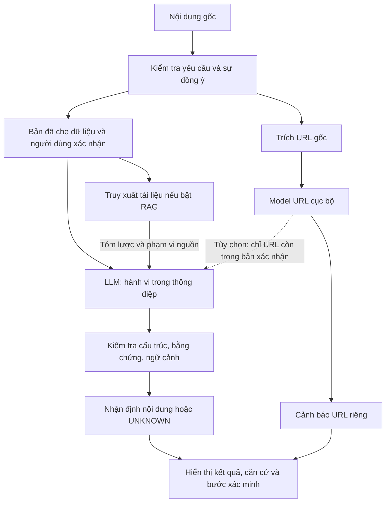

# Thiết kế và cải tiến chất lượng phát hiện v3

Ngày: 02/11/2026. Phạm vi: kiến trúc xử lý, kiểm soát kết luận và đánh giá. Đây là tài liệu kỹ thuật của dự án; báo cáo học phần vẫn được giữ riêng trong `docs/reports/`.

## 1. Quyết định thiết kế

PhishLens hỗ trợ người dùng kiểm tra yêu cầu đáng ngờ trong tin nhắn và chuỗi URL. Kết quả cần trả lời ba câu hỏi: nội dung đang yêu cầu hành động gì, đường dẫn có cảnh báo riêng không, và tài liệu nào hỗ trợ lời giải thích. Chưa có thành phần xác minh danh tính người gửi hoặc nội dung trang đích.

Giữ kiến trúc một ứng dụng FastAPI với các dịch vụ nội bộ có trách nhiệm rõ ràng. Chưa cần tách microservice, thêm vector database hoặc đổi mô hình embedding khi các lỗi quan trọng hiện nằm ở hợp đồng đầu ra và cách đánh giá.



Đường đi LLM/RAG chỉ chạy khi bật AI và có xác nhận gửi nội dung. Sơ đồ mô tả chế độ tin nhắn; chế độ URL lấy kết luận từ model URL. Nếu người dùng bật AI ở chế độ URL, ứng dụng vẫn có thể gọi prompt legacy để giải thích; chưa triển khai chính sách tự tắt lượt gọi đó.

## 2. Các thay đổi đã triển khai

| Thành phần | Thay đổi | Tác dụng và giới hạn |
|---|---|---|
| `app/analysis_service.py` | Tách điều phối khỏi route HTTP; kiểm tra cả bản đã sửa trước khi xử lý; ghi thời gian từng bước | Có thể kiểm thử lỗi thành phần và phạm vi dữ liệu độc lập với giao diện |
| `app/main.py` | Route gọi dịch vụ điều phối; runtime tin nhắn dùng `message-v3` | Giữ cùng API đầu vào và các trường kết quả cũ; bổ sung `execution` |
| `app/verdict_validation.py` | Loại bằng chứng trống, không xuất hiện trong đầu vào, chỉ gồm URL hoặc ký hiệu che dữ liệu; yêu cầu ngữ cảnh rõ | Cảnh báo thiếu bằng chứng hợp lệ chuyển thành `UNKNOWN`; không tự coi nhãn `quoted_example` là an toàn |
| Prompt `message-v3` | Yêu cầu phân loại ngữ cảnh, tách hành vi và uy tín URL, xét phạm vi tài liệu | Prompt mới cần được đo riêng; không dùng F1 của prompt cũ làm kết quả v3 |
| Hướng dẫn khi `UNKNOWN` | Dùng hướng dẫn xác minh cố định, bỏ phần nguồn dẫn chưa đủ căn cứ | Tránh giữ hành động do AI đề xuất sau khi kết luận đã bị bác bỏ |
| RAG | So ngưỡng bằng điểm làm tròn 6 chữ số giống dữ liệu hiệu chỉnh; vẫn xếp thứ tự theo cosine gốc | Sửa sai khác sát ngưỡng; không thay ngưỡng đã chốt |
| Metadata RAG | Opt-in nối metadata từ đúng tài liệu trong corpus đã kiểm tra hash | Có thể truyền `kind`, `scenario`, `entity`, `document_role`, `scope`, `valid_from`, `temporal_note` tới prompt v3; không tự suy đoán trường thiếu |
| Công cụ ablation | Hỗ trợ v3 ở cả bốn cấu hình, bắt buộc manifest nhãn đã review khi chạy benchmark | `--diagnostic` vẫn chỉ phục vụ kiểm tra, không trở thành gold |
| Đánh giá PhishVN | Kiểm tra cấu hình/checkpoint trước khi ghi vào thư mục kết quả | Từ chối chạy sai cấu hình mà không làm hỏng snapshot cũ |
| Chẩn đoán URL offline | Báo kết quả theo nguồn/tier, khoảng Wilson, precision theo tỷ lệ phishing giả định | Đọc dự đoán đã lưu, không huấn luyện hoặc gọi lại API |

`execution.requested` ghi các tùy chọn được yêu cầu. Các trường thành phần ghi thực tế có kết quả hay không: ví dụ bật RAG nhưng chỉ mục không sẵn sàng vẫn có thể nhận kết quả LLM không kèm nguồn. `included_in_successful_llm_call` chỉ xác nhận nguồn được đính kèm ở lượt LLM trả kết quả hợp lệ; giá trị `false` khi lỗi không chứng minh provider chưa nhận dữ liệu. Profile dự kiến vẫn được ghi khi LLM lỗi.

`llm.validation` có phiên bản, trạng thái `valid` / `filtered` / `abstained`, mã lý do và mức cảnh báo ban đầu. `valid` chỉ có nghĩa đạt kiểm tra cấu trúc; **không phải xác nhận kết luận đúng**. Kiểm tra substring chưa chứng minh đoạn trích hỗ trợ lập luận hoặc tài liệu áp dụng cho trường hợp cụ thể. Trường `semantic_support_verified` luôn là `false`.

Các prompt/parser legacy và message-v2 được giữ để so sánh lịch sử. Runtime đổi sang v3 nhưng corpus/model URL/ngưỡng vẫn giữ cấu hình hiện tại. Corpus v1 thiếu nhiều metadata phạm vi; hỗ trợ trường mới không có nghĩa đã bổ sung đủ metadata hoặc đã đưa corpus v2 vào ứng dụng.

## 3. Quy tắc cảnh báo

| Tình huống | Kết quả nội dung | Kết quả URL / hành động |
|---|---|---|
| Nội dung LOW, URL HIGH | Giữ LOW ở phạm vi nội dung | Cảnh báo URL HIGH được hiển thị riêng, yêu cầu xác minh |
| Nội dung HIGH, URL LOW | Giữ HIGH nếu bằng chứng hợp lệ về cấu trúc | Điểm URL thấp không bác bỏ yêu cầu nguy hiểm |
| Chỉ có chuỗi URL trong ô tin nhắn | UNKNOWN cho hành vi | Giữ kết quả URL |
| AI thiếu ngữ cảnh hoặc cảnh báo không có bằng chứng hợp lệ | UNKNOWN | Thay hướng dẫn AI bằng bước xác minh cố định |
| AI lỗi hoặc đang tắt | UNKNOWN cho nội dung | Model URL vẫn trả kết quả nếu có URL |
| Không tìm được tài liệu | Có thể phân tích bằng LLM | Ghi rõ không có nguồn RAG; không tạo nguồn giả |

Không dùng phép lấy mức cảnh báo cao nhất để biến một URL bị báo động thành kết luận toàn bộ tin nhắn lừa đảo. Không dùng điểm cosine, điểm XGBoost hoặc trường `valid` làm phần trăm độ chắc chắn.

## 4. Vấn đề cần ưu tiên tiếp theo

Kết quả lịch sử trên 8.941 URL PhishVN có F1 khoảng 89,76% tại ngưỡng WARNING, nhưng FPR khoảng **29,26%**. Riêng nguồn Tranco có FPR khoảng **87,39%**. Điều này phù hợp với phản ánh báo nhầm nhiều của người dùng; thêm RAG không trực tiếp sửa được bộ phân loại URL.

Nguồn số liệu: [đánh giá PhishVN](../evaluation/PHISHVN.md), [snapshot dự đoán và cấu hình](../../artifacts/evaluations/phishvn_official_v1/). Chẩn đoán theo nguồn là phân tích lỗi trên test đã xem, không được dùng để chọn lại ngưỡng rồi tuyên bố đó là kết quả test độc lập.

### Ưu tiên 1: nhãn và bộ kiểm tra độc lập

Hoàn thiện review cho 200 SMS đã chuẩn bị: hai người gán nhãn độc lập, phân xử bất đồng, cho phép không đủ thông tin; khóa manifest/hash trước chạy. Nhãn AI sơ bộ chỉ giúp sắp thứ tự review. Giữ nhóm domain/template độc lập giữa dev và test, không đưa nội dung hoặc đáp án test vào kho RAG.

Thêm các nhóm khó còn thiếu trong bộ review tiếp theo: thông báo thật có OTP/đường dẫn, tin giáo dục trích dẫn thủ đoạn, quảng cáo gây phiền nhưng chưa có hành vi lừa đảo, đổi tài khoản nhận tiền, giả danh người quen, QR/device-code, yêu cầu cài APK, gây sức ép tâm lý, tin không dấu và prompt injection. Nhãn phải dựa vào ngữ cảnh được cung cấp; không suy luận người gửi thật chỉ từ tên thương hiệu.

### Ưu tiên 2: giảm báo nhầm của model URL

Tạo thí nghiệm mới, giữ model hiện tại làm đối chứng. So sánh XGBoost hiện tại với một baseline đơn giản và cấu hình tái huấn luyện trên split domain/time đã khóa. Bổ sung URL hợp lệ đa dạng vào tập huấn luyện và validation, đặc biệt dạng URL mà mô hình đang báo nhầm. URL đã dùng để xem lỗi không được tái sử dụng làm test độc lập.

Chọn ngưỡng trên validation theo ràng buộc nghiệp vụ được chốt trước, báo đồng thời Recall/FPR và số cảnh báo trên 1.000 URL hợp lệ. Ngưỡng WARNING và HIGH có mục tiêu riêng; nếu không đạt ràng buộc thì ghi rõ không đạt. Không đặt ngưỡng riêng theo trường `source` của dataset vì ứng dụng không biết trường này khi nhận URL thật.

### Ưu tiên 3: đo đúng đóng góp của RAG

Trước hết chạy bốn cấu hình v3 trên cùng gold test: LLM; LLM + URL; LLM + RAG; LLM + RAG + URL. Cùng model/prompt profile, điều kiện gọi và bộ nhãn; log token, lỗi, thời gian và số lần abstain. Không loại mẫu lỗi để tăng F1.

RAG cần được chấm cả **nguồn đúng và lời giải thích hữu ích**, bên cạnh nhãn phishing. Review relevance truy xuất độc lập với nhãn phishing; chấm tay dấu hiệu đúng, nguồn có liên quan, đoạn trích thực sự hỗ trợ claim và hành động đề xuất phù hợp. Ghi riêng từng tiêu chí thay vì gộp tùy tiện thành một điểm phần trăm.

Một nhánh thử nghiệm sau đó: LLM phân loại nội dung trước; RAG dùng ở bước giải thích và hướng dẫn xác minh, không đổi nhãn ban đầu. So nhánh này với RAG cùng lượt hiện tại; tính thêm token/độ trễ của lượt thứ hai. Chỉ triển khai mặc định nếu có lợi ích đo được. Nếu RAG không tăng F1 nhưng cải thiện giải thích có nguồn, báo đúng đóng góp đó.

Với corpus v2, cần review các bài hướng dẫn hợp lệ cùng bài cảnh báo; ghi phạm vi dịch vụ, thời điểm, dạng tài liệu và điều kiện áp dụng. Không dùng tên cơ quan đăng bài như bằng chứng dịch vụ đó đang bị giả mạo; không dùng hướng dẫn hợp lệ của một đơn vị để xác nhận mọi tin nhắn cùng từ khóa. E5 v1 vẫn là mặc định trong lúc các thử nghiệm BM25/hybrid/bỏ dấu và corpus v2 chưa qua review mới.

## 5. Đo lường và tái lập

Theo dõi Precision/Recall/F1, FPR, coverage và lỗi kỹ thuật; báo theo nhóm có/không URL, loại kịch bản và các nguồn dữ liệu. `UNKNOWN` là abstention: mẫu phishing UNKNOWN được tính là chưa phát hiện trong Recall/F1; phải báo thêm coverage để tránh che giấu mẫu không kết luận. F1 phân loại không chấm chất lượng lời giải thích.

Các khoảng Wilson trong báo cáo URL mới là khoảng 95% cho Recall/FPR theo giả định các URL độc lập. Các URL cùng domain có thể phụ thuộc; chưa có bootstrap theo domain, nên không coi đây là chứng minh cải thiện có ý nghĩa thống kê. Precision theo prevalence là phép tính kịch bản với TPR/FPR cố định, không phải số đo triển khai thực tế.

Các lệnh offline:

```bash
.venv/bin/python -m pytest -q
.venv/bin/python -m evaluation.url_diagnostics --help
.venv/bin/python -m evaluation.ablation --help
```

Tạo báo cáo chẩn đoán vào một thư mục mới:

```bash
.venv/bin/python -m evaluation.url_diagnostics \
  --run-dir artifacts/evaluations/phishvn_official_v1 \
  --out artifacts/evaluations/url_diagnostics_v1
```

Lượt này đã tạo `artifacts/evaluations/url_diagnostics_v1/report.md` và `summary.json` cục bộ. Khi chạy lại, chọn `--out` khác vì công cụ từ chối ghi đè.

Thực nghiệm v3 thật sử dụng `--prompt-profile message-v3 --fusion-policy separate` và manifest reviewed-gold hợp lệ; xem [quy trình review](../../data/annotation/vn_sms_v2/README.md). Các cấu hình cũ dùng đúng profile cũ, thư mục kết quả cũ giữ nguyên. Mỗi thí nghiệm mới cần thư mục mới, dấu vết cấu hình và hash đầu vào.

Kiểm tra ngày 02/11: **202 pytest đạt**; giao diện đạt ở bốn kích thước 1440, 820, 390 và 320 px với 24 phản hồi AI phát lại và 12 yêu cầu cục bộ, không có lượt gọi provider. Truy xuất thử bằng E5 cục bộ trả ba nguồn đúng hợp đồng kết quả; đây chưa phải phép đo relevance. Test vẫn có một cảnh báo deprecation từ thư viện Starlette/TestClient.

Chưa gọi LLM để đo lại F1, chưa huấn luyện lại model URL, chưa có kết luận v3 tốt hơn trên dữ liệu thực. Bộ regression toàn đúng chỉ chứng minh các tình huống kiểm thử đó chạy đúng.
