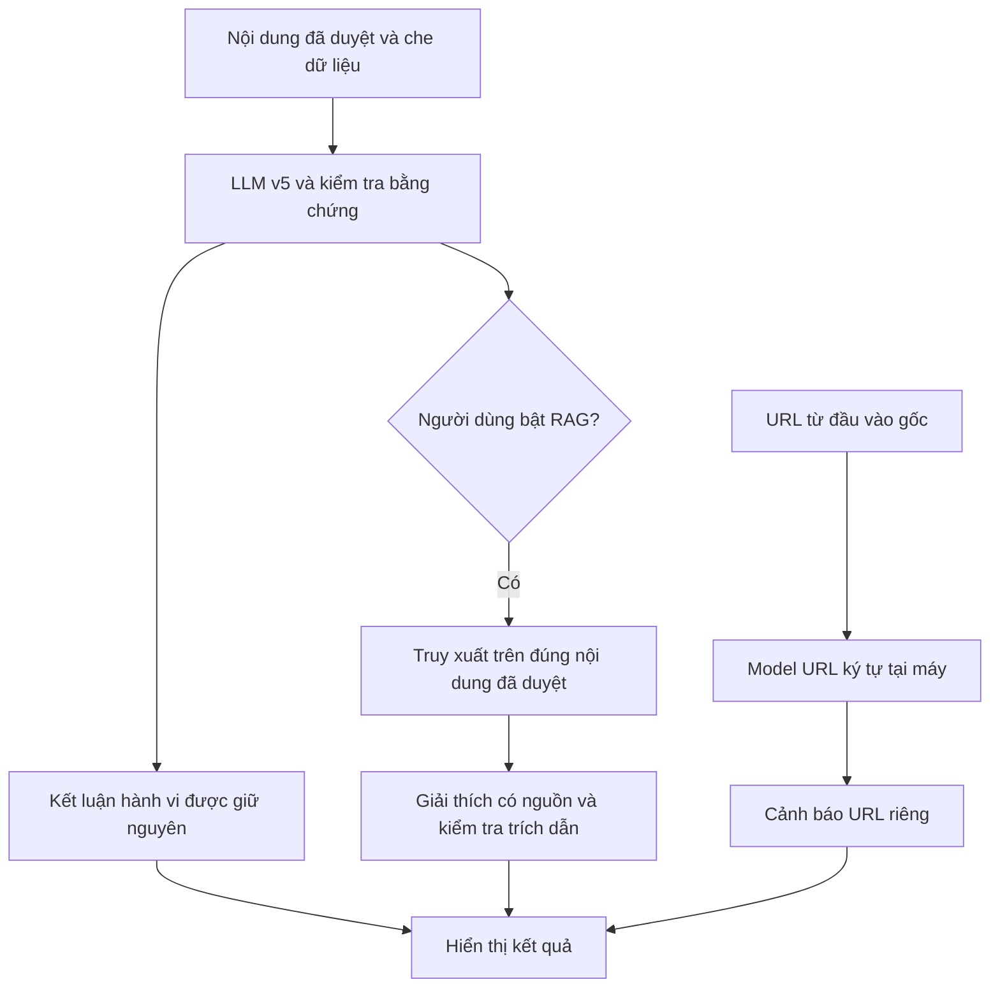

# Bản thử nghiệm v5: phân biệt injection, URL ký tự và RAG sau phân loại

Ngày triển khai thử: **06/11/2026**. Đây là profile **opt-in**, không thay mặc định `python run.py`. Ba nhánh được kiểm tra riêng để biết cải thiện đến từ đâu; chưa có nhãn người hoặc test ngoài mới để chứng nhận chất lượng triển khai.

## 1. Những gì đã thay đổi

| Thành phần | Thay đổi | Cách giữ mốc đối chiếu |
|---|---|---|
| Nội dung | Prompt `message-v5` phân biệt lệnh thao túng AI với hành vi lừa đảo người nhận | Cùng `MessageVerdict`, transport và validator v4; không hardcode nhãn theo câu mẫu |
| URL | TF-IDF ký tự 3–5 gram + Logistic Regression | Một cấu hình khóa trước fit, cùng split chính thức; model XGBoost cũ giữ nguyên |
| RAG | Phân loại trước, tài liệu chỉ bổ sung giải thích sau đó | `post_explanation` riêng; schema không cho trả nhãn rủi ro mới hoặc sửa verdict |
| Giao diện | Khối nguồn bổ sung riêng, trạng thái thử nghiệm và thời gian chờ cho hai bước | V4 vẫn hiển thị như trước; dùng `textContent`, giữ bước duyệt/xác nhận nội dung |



### Phạm vi sửa injection

Checkpoint v4 trước có 5 cảnh báo nhầm ở nhóm `education_injection`: mô hình dùng việc cố ép AI trả HIGH làm căn cứ gọi thông điệp là scam, ngay cả khi giải thích thừa nhận không có yêu cầu gửi bí mật/tiền. V5 yêu cầu xác định ai được yêu cầu làm gì và phân biệt trích dẫn với yêu cầu đang diễn ra. Câu ép HIGH và LOW đều không tự nâng/hạ rủi ro lừa đảo; tự xưng là bài học cũng không miễn trừ một yêu cầu nguy hiểm thật.

Để so sánh prompt công bằng, lượt đầu **chưa thêm trường JSON `injection_suspected`**. Hai loại rủi ro được phân biệt trong rubric; `risk_level` vẫn chỉ mô tả hành vi lừa đảo. Thêm trường chẩn đoán injection cần một phiên bản schema và đánh giá riêng. Không tuyên bố đã có bộ phát hiện injection hoặc chống mọi injection.

### Phạm vi RAG

Ứng dụng truy xuất sau khi phân loại thành công, bằng chính bản nội dung đã duyệt và che dữ liệu; không dùng nhãn/summary do model sinh làm truy vấn. Không cấp tài liệu RAG cho lượt phân loại trong profile này. Tối đa ba nguồn được chuyển cho bước giải thích riêng.

Schema giải thích chỉ có các claim, trích đoạn đầu vào/nguồn, quan hệ `mechanism_match` hoặc `verification_step`, giới hạn phạm vi và hành động gắn mã nguồn. Mọi ID/quote phải tồn tại trong dữ liệu đã cấp; sai schema/nguồn thì bỏ toàn bộ giải thích. RAG rỗng, lỗi API hoặc trích dẫn không hợp lệ không xóa kết quả phân loại/URL đã có. Hai lượt API có usage riêng, dùng chung giới hạn đồng thời, xác nhận gửi và kiểm tra endpoint.

`semantic_support_verified=false` luôn được giữ: trích đoạn khớp chỉ là kiểm tra cấu trúc, chưa chứng minh claim đúng ngữ nghĩa. Nguồn được gọi đúng là **bản tóm lược biên tập**, không giả nhận là nguyên văn bài gốc. Chất lượng nguồn/lời giải thích vẫn cần chấm theo rubric; không mặc định post-RAG tốt hơn chỉ vì không sửa nhãn.

## 2. Kết quả URL đã hoàn tất

Trên gold/silver test lịch sử, cùng ngưỡng 0,5:

| Chỉ số | XGBoost đang dùng | TF-IDF ký tự + LR |
|---|---:|---:|
| Recall | 62,83% | 72,48% |
| FPR | 5,62% | 2,57% |
| F1 | 60,65% | 75,19% |
| TP / FP | 306 / 216 | 353 / 99 |

Trên validation cross-fit theo miền, cùng mục tiêu FPR 5%: XGBoost phát hiện **20/24 dương core**, có **80/1.561 FP**; ký tự là **22/24**, **77/1.561 FP**. Tại mục tiêu 1%, ký tự có thêm một FP và Recall OpenPhish thấp hơn; không thắng mọi nguồn.

Đây là test/validation đã xem, không là bằng chứng ngoài mới. XGBoost đã dùng validation cho early stopping/chọn cấu hình, nên đây là so sánh pipeline, không tách riêng tác dụng LR và TF-IDF. [Bảng đầy đủ và giới hạn](../evaluation/URL_CHAR_BASELINE_V1.md), [biểu đồ](../../artifacts/evaluations/url_char_baseline_v1/comparison.png).

Model ký tự được export JSON/NPZ, không dùng pickle. Phát lại đúng cấu hình một lần để đóng gói, không tìm tham số mới; vocabulary/IDF/hệ số khớp hash và **16.207 score validation/test khớp từng bit** với checkpoint, kể cả dịch vụ dựng lại. Runtime kiểm tra phiên bản thư viện và hash mã/trọng số; thiếu export hoặc mismatch thì báo chưa sẵn sàng, không ngầm đổi model.

Profile candidate dùng LOW dưới 0,5, UNKNOWN từ 0,5 đến dưới **0,5259423981707284**, HIGH từ mốc này. LOW là dải điểm chưa thấy dấu hiệu rõ, không xác minh an toàn. Mốc HIGH lấy từ chính sách FPR 5% trên validation lịch sử, chưa bảo đảm FPR ngoài thực tế. Không lấy ngưỡng XGBoost áp sang score LR.

Thử nhanh các URL quen thuộc vẫn thấy lỗi: `example.com` và URL GitHub của chính dự án bị cả XGBoost lẫn model mới cảnh báo HIGH; `example.org` là HIGH ở XGBoost và UNKNOWN ở ký tự. Các ca này được ghi **sau fit, không dùng để sửa ngưỡng/nhãn**. [Dữ liệu smoke](../../artifacts/evaluations/url_char_baseline_v1/smoke_examples.json). Điểm toàn tập tốt hơn chưa giải quyết hết báo nhầm khi dùng thực tế.

## 3. Pilot v4/v5 và RAG

Protocol đã khóa trước gọi API:

- **120 đầu vào dev:** toàn bộ 80 SMS và 40 ngữ cảnh thuộc tám miền đã được chọn từ pilot trước; giữ 29 SMS UNKNOWN và các ca injection. Không chạy test.
- **240 yêu cầu chính:** v4/v5 nhận cùng văn bản, schema, validator, dịch vụ, temperature 0,1, trần 8.192 token và timeout 90 giây. Không cấp score URL hoặc RAG cho cả hai arm chính.
- **16 ca có nguồn**, chọn bằng hash trước kết quả: 8 SMS + 8 ngữ cảnh. So v5 nhận nguồn trước phân loại với nguồn đó dùng để giải thích sau kết luận v5 plain đã giữ nguyên. Dùng cùng retrieval snapshot cũ để tách tác động thứ tự; chưa thử đổi corpus/embedding.
- **8 đối chứng retrieval rỗng:** payload pre-RAG giống hệt plain thì dùng chung kết quả, không tạo chênh giả do gọi lại.
- **8 lượt v5 lặp độc lập:** chọn trước theo hash để đo sơ bộ dao động sinh, tách khỏi nhóm dùng chung kết quả.
- Tối đa **280 yêu cầu provider**, hai worker; dừng ở lỗi HTTP nghiêm trọng, ba lỗi liên tiếp hoặc trần usage ghi nhận 1,5 triệu token. Usage thiếu không có nghĩa chi phí bằng 0; đây không phải trần hóa đơn đã xác minh.
- Journal trước khi gửi; một lần thử mỗi yêu cầu. Lỗi/UNKNOWN giữ nguyên; lần bị ngắt đã bắt đầu không được gửi lại. Không chỉnh prompt hoặc chọn mẫu lại trong lượt.

Tiêu chí dev đặt trước: giảm ít nhất hai cảnh báo nhầm giáo dục; Recall ngữ cảnh ≥93,75%; Recall SMS ≥8/9; không tăng quá hai FP SMS; coverage ≥90% và không giảm quá 5 điểm phần trăm. Đạt chỉ là điều kiện phát triển trên nhãn tham chiếu cố định, không là chứng nhận độc lập.

### Kết quả hoàn tất

Đủ **280/280 yêu cầu provider**, **296/296 bản ghi logic**: 240 phân loại chính, 16 pre-RAG có nguồn, 16 post-RAG có nguồn, 8 lượt lặp; thêm 8 bản ghi pre-RAG dùng chung kết quả và 8 post-RAG không gọi vì thiếu nguồn. Đã đối chiếu raw response, payload/journal/hash và Precision/Recall/F1 bằng scikit-learn. Không gọi lại lỗi hoặc mở test.

| Nhóm / chỉ số | V4 trong lượt này | V5 trong lượt này |
|---|---:|---:|
| SMS: phát hiện / 9 dương AI | 9/9 | 9/9 |
| SMS: cảnh báo nhầm / 42 âm AI | 1/42 | 0/42 |
| SMS: F1 | 94,74% | 100,00% |
| SMS: accuracy / coverage | 98,04% / 100% | 100% / 100% |
| Ngữ cảnh: phát hiện / 16 dương theo thiết kế | 16/16 | 16/16 |
| Ngữ cảnh: cảnh báo nhầm / 16 âm | 4/16 | 0/16 |
| Ngữ cảnh: UNKNOWN âm | 0 | 1, do OUTPUT_INVALID |
| Ngữ cảnh: F1 | 88,89% | 100,00% |
| Ngữ cảnh: accuracy / coverage | 87,50% / 100% | 96,88% / 96,88% |

V5 đạt các tiêu chí dev đã đặt trước. **F1 ngữ cảnh 100% không phải đúng 32/32:** chỉ đúng 31/32, một âm bị lỗi JSON và giữ UNKNOWN. Trong bốn FP v4, ba ca trở thành LOW đúng theo tham chiếu, một ca thành UNKNOWN nên vẫn chưa tính đúng. Không thay lỗi gốc bằng lượt lặp trả LOW. SMS 51/51 đúng theo nhãn AI vẫn chỉ có chín dương và dữ liệu đã được dùng phát triển prompt; không đại diện cho độ chính xác thực tế.

V4 ở lượt mới khác nhẹ pilot trước (ví dụ một FP SMS thay vì 0). Đây là lý do chạy đối chứng mới cùng thời điểm, không ghép số v4 cũ với v5 mới để tính mức cải thiện. 29 SMS nhãn UNKNOWN được giữ riêng, không được tính đúng/sai.

Nhóm lặp có **2/8 cặp khác mức đầu ra**, đều UNKNOWN → LOW, một cặp gốc là lỗi JSON; không có cặp đổi giữa có/không phát cảnh báo. Cỡ tám rất nhỏ, không chứng nhận tính ổn định. Nhóm retrieval rỗng cho kết quả giống nhau do dùng chung phản hồi theo thiết kế, không phải tám lần sinh độc lập giống nhau.

Ở 16 ca có nguồn, thêm RAG trước phân loại chưa thay đổi các nhãn nhị phân đã chấm: 6 SMS có nhãn nhị phân (5 dương/1 âm), 2 SMS UNKNOWN và 8 ngữ cảnh (5 dương/3 âm). Đây là nhóm nhỏ được chọn theo có nguồn, không dùng làm F1 tổng cho cả bộ SMS.

Post-RAG theo validator V1: **5/16** có hỗ trợ qua kiểm tra cấu trúc, **4/16** trả không có nguồn hỗ trợ và **7/16** lỗi. Bảy lỗi gồm 3 `OUTPUT_TRUNCATED` và 4 `SOURCE_NOT_GROUNDED`. Kiểm tra phản hồi cho thấy cả bốn lỗi thứ hai do nhiều claim khác nhau cùng dùng một mã tài liệu; các quote nguồn vẫn khớp. Đây là ràng buộc validator quá chặt, không phải bốn bằng chứng quote bị bịa. [Chẩn đoán giữ nguyên phản hồi](../../artifacts/evaluations/improvement_pilot_v1/failure_diagnostic.json).

Việc sửa parser được thực hiện thành phiên bản riêng và chấm lại offline trên cùng phản hồi, không sửa checkpoint/summary V1, nhãn hay kết quả phân loại. Ba phản hồi cắt ngắn vẫn là lỗi. Phần chấm ngữ nghĩa lời giải thích chưa hoàn thành; không kết luận post-RAG tốt hơn từ số quote khớp.

Parser V2 cho nhiều claim khác nhau cùng dẫn một tài liệu, vẫn kiểm tra mọi quote/ID và từ chối claim trùng hoàn toàn. Chấm lại cùng 16 raw response cho **9 có hỗ trợ qua cấu trúc / 4 không hỗ trợ / 3 lỗi cắt ngắn**. Không thay prompt/schema, không tạo thêm phản hồi API, không sửa F1 phân loại. Candidate app dùng parser V2; [bảng chấm lại và hash](../../artifacts/evaluations/improvement_pilot_v1/post_parser_v2.json) giữ riêng với báo cáo V1. Đây là sửa hợp đồng validator, không phải bằng chứng LLM sinh lời giải thích tốt hơn.

Usage ghi nhận **1.440.261 token**, chưa đối chiếu hóa đơn. Post-RAG phát sinh thêm 16 yêu cầu so với dùng các kết luận đã có; chưa chứng minh lợi ích ngữ nghĩa đủ bù chi phí. Vì vậy RAG tiếp tục opt-in, profile vẫn thử nghiệm.

Post-RAG không đổi nhãn theo thiết kế. Vì vậy không dùng F1 bằng plain làm bằng chứng RAG cải thiện phân loại; phải đọc tỷ lệ nguồn có ích, claim được hỗ trợ và chi phí riêng. Phiếu chấm mù cấu hình giữ trống cho người review; nội dung phản hồi khác nhau vẫn có thể làm lộ cấu hình, nên không coi là mù hoàn toàn.

## 4. Chạy thử ứng dụng

Trên máy hiện tại đã có export và chỉ mục. Chạy profile thử nghiệm bằng:

```bash
LLM_MAX_TOKENS=8192 LLM_TIMEOUT_SECONDS=90 \
  .venv/bin/python -B -m uvicorn app.candidate:app \
  --host 127.0.0.1 --port 8001 --no-access-log
```

Mở **http://127.0.0.1:8001**. Giao diện có nhãn “Bản thử nghiệm”. RAG vẫn cần bật trong thiết lập; bước giải thích có thể phát sinh thêm một yêu cầu API sau phân loại. Khi không có nguồn hoặc phân loại lỗi, không gọi bước này. URL vẫn xử lý tại máy; AI chỉ nhận bản nội dung đã được duyệt.

Muốn thử v5/post-RAG nhưng giữ XGBoost làm đối chứng URL:

```bash
PHISHLENS_CANDIDATE_URL_MODEL=xgboost \
  .venv/bin/python -B -m uvicorn app.candidate:app \
  --host 127.0.0.1 --port 8001 --no-access-log
```

`python run.py` vẫn chạy v4/XGBoost ở cổng mặc định. Candidate không tự nâng thành bản mặc định sau pilot.

Máy clone mới cần chuẩn bị lại export từ thí nghiệm URL, không có trọng số trong Git:

```bash
.venv/bin/python -B -m app.url_char_service export \
  --audit-dir artifacts/evaluations/url_char_baseline_v1
```

Lệnh từ chối ghi đè export có sẵn; cần dữ liệu/model/checkpoint đúng hash như [hướng dẫn URL](../evaluation/URL_CHAR_BASELINE_V1.md).

## 5. Kiểm chứng và tệp

- [Protocol pilot](../../artifacts/evaluations/improvement_pilot_v1/execution.json), [checkpoint/summary](../../artifacts/evaluations/improvement_pilot_v1/summary.json).
- [Báo cáo số học đầy đủ](../../artifacts/evaluations/improvement_pilot_v1/report.md), [kiểm chứng](../../artifacts/evaluations/improvement_pilot_v1/verification.json), [phiếu chấm giải thích](../../artifacts/evaluations/improvement_pilot_v1/explanation_blind.csv).
- [Biểu đồ số ca đúng/cảnh báo nhầm/chưa kết luận](../../artifacts/evaluations/improvement_pilot_v1/comparison.png), [SVG](../../artifacts/evaluations/improvement_pilot_v1/comparison.svg).
- [Model ký tự và provenance](../../artifacts/evaluations/url_char_baseline_v1/deployment/export.json).
- [Bộ chạy pilot](../../evaluation/improvement_pilot.py), [prompt v5](../../app/message_policy_v5.py), [RAG giải thích](../../app/rag_explanation.py), [profile ứng dụng](../../app/candidate.py).
- [Kiểm chứng giao diện](../../artifacts/ui/candidate/verification.json): bốn cỡ màn hình 320–1440px, nguồn thành công/rỗng/lỗi, XSS và timeout; AI được replay, **0 provider calls**.

Kiểm tra lại pilot đã hoàn tất, không gọi API hoặc ghi lại phiếu chấm:

```bash
.venv/bin/python -B -m evaluation.improvement_pilot verify \
  --out artifacts/evaluations/improvement_pilot_v1
```

**373 kiểm thử offline đạt** sau khi tích hợp parser V2. Các kiểm tra offline và giao diện khẳng định cấu trúc/phép tính và sự tách các bước; chưa khẳng định nhãn AI, relevance hay mọi giải thích đều đúng. Báo cáo học thuật hiện có không bị sửa hoặc đưa lên Git bởi lượt thử này.
