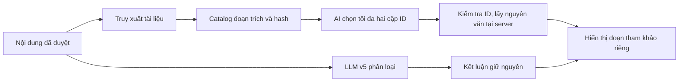

# Nghiên cứu tiếp: kiểm tra dấu vết dữ liệu và RAG chọn bằng chứng

Cập nhật **07/11/2026**. Đây là công việc phát triển sau [pilot v5](QUALITY_V5_TRIAL.md), không phải báo cáo học thuật hoặc kết quả trên bộ test độc lập mới. Giữ nguyên các checkpoint, prompt và runner đã khóa; mọi thử nghiệm mới có thư mục và protocol riêng.

## 1. Quyết định từ kết quả hiện có

| Hướng | Đã thực hiện | Quyết định |
|---|---|---|
| URL: bỏ marker tiền xử lý | Một fit train-only, đối chứng cùng cấu hình LR/TF-IDF, chỉ chấm validation | Không triển khai: báo nhầm tăng và Recall OpenPhish giảm |
| RAG: chọn ID đoạn trích | Module có schema/validator riêng, render nguyên văn tại server, đối chứng mới giới hạn 32 yêu cầu | Chỉ opt-in; đánh giá độ ổn định kỹ thuật và chi phí, chưa có điểm relevance của người |
| Dữ liệu mới | Công cụ đăng ký trước, khóa bằng chứng, chặn trùng miền/campaign và tách nhãn sơ bộ/đã review | Chưa có bộ dữ liệu mới đủ nhãn; không gọi công cụ là một bộ test đã hoàn thành |

Ứng dụng mặc định vẫn là v4/XGBoost. Candidate giữ URL ký tự V1; không thay bằng ablation V2 vừa thất bại. Prompt phân loại v5 không được chỉnh thêm trong lượt này.

## 2. URL: kiểm định giả thuyết thay vì sửa theo vài ví dụ

Các n-gram quanh ký hiệu `[PATH]` xuất hiện trong một số đóng góp dương, nhưng cộng riêng n-gram nằm trong marker ở ví dụ `example.com` lại là âm. Không đủ căn cứ kết luận marker gây cảnh báo nhầm. Vì vậy đã chạy một ablation: giữ cấu hình học, chỉ bỏ marker do tiền xử lý thêm vào; không xóa chuỗi thật trong URL, không tìm lại tham số.

Trên **validation gold/silver**, có 24 dương và 1.561 âm:

| Chính sách | V1 giữ marker | V2 bỏ marker |
|---|---:|---:|
| Ngưỡng 0,5: phát hiện dương | 22/24 | 23/24 |
| Ngưỡng 0,5: báo nhầm | 95/1.561 | 168/1.561 |
| Ngưỡng 0,5: FPR | 6,09% | 10,76% |
| Cross-fit nhắm FPR 5%: phát hiện dương | 22/24 | 21/24 |
| Cross-fit nhắm FPR 5%: báo nhầm | 77/1.561 | 77/1.561 |

Recall OpenPhish tại ngưỡng 0,5 còn giảm **96,55% → 27,59%**. V2 giảm score một vài URL đã biết nhưng không cải thiện tổng thể. Không đọc/chấm lại official test trong lượt này. [Cấu hình, bảng nguồn/tier và giới hạn](../evaluation/URL_REPRESENTATION_V2.md).

Một dấu vết đáng kiểm tra tiếp là `www`: trên train, tỷ lệ có tiền tố này là 49,32% ở Chống Lừa Đảo, nhưng 0,05% ở Tranco toàn cầu và 0% ở Tranco VN. Đây là khác biệt nguồn, chưa chứng minh quan hệ nhân quả. Không tự xóa `www`, không tự cho hai hostname cùng nhãn, không dùng tên miền nổi tiếng làm luật bỏ qua cảnh báo.

OOD/coverage cũng chưa giải quyết được: GitHub có ít n-gram được hỗ trợ hơn trong vocabulary, nhưng `www.google.com` có coverage 100% vẫn bị HIGH. Không chuyển coverage cao thành “an toàn”.

## 3. Vì sao điểm cao chưa đủ để đưa ra cảnh báo đáng tin

Tính lại từ số đếm đã lưu, không chạy inference:

- URL ký tự ở ngưỡng 0,5 có Recall 353/487. Khoảng Wilson 95% minh họa là **68,35–76,26%**; FPR 99/3.845 có khoảng **2,12–3,12%**.
- Nếu **giả định** ngoài thực tế chỉ 1% URL là phishing và Recall/FPR giữ nguyên, Precision suy ra chỉ khoảng **22,14%**. Đây là phép chiếu theo tỷ lệ lớp giả định, không phải số đo triển khai.
- SMS v5 phát hiện 9/9 dương theo nhãn AI. Ngay trong giả định nhị thức độc lập, khoảng Recall vẫn khoảng **70,09–100%**; 0/42 báo nhầm không có nghĩa FPR thực bằng 0 (cận trên Wilson khoảng **8,38%**).

Wilson giả định các quan sát độc lập; URL dùng chung miền và ngữ cảnh dùng chung mẫu có thể vi phạm giả định này. Các khoảng trên chỉ minh họa thiếu độ chắc chắn, không thay cluster bootstrap, nhãn người hoặc dữ liệu ngoài mới. [Số học và hash đầu vào](../../artifacts/evaluations/research_next_v1/uncertainty.json) dùng lại `wilson95`/`projected_precision` đã có trong dự án.

Điểm LR đang là score của mô hình dùng class weighting, chưa là xác suất lừa đảo được hiệu chỉnh trên phân phối sử dụng. Chính sách ngưỡng cần validation đại diện; không hứa Precision cao chỉ từ tên HIGH. [Tài liệu calibration chính thức](https://scikit-learn.org/stable/modules/calibration.html) giải thích sự khác biệt giữa score và xác suất được hiệu chỉnh.

## 4. RAG chọn bằng chứng thay cho viết lại đoạn trích

[Module mới](../../app/rag_evidence_v3.py) chia đúng nội dung đã duyệt và tài liệu đã truy xuất thành các đoạn có ID, offset và hash catalog. AI chỉ chọn tối đa hai cặp ID, cùng quan hệ `mechanism_match` hoặc `verification_step`. Server lấy lại nguyên văn theo ID; không yêu cầu AI chép lại quote dài hoặc viết claim/hành động mới.



Không có đoạn hỗ trợ thì `selections=[]`; ID lạ, trường nhãn mới, lựa chọn trùng hoặc phản hồi cắt ngắn đều bị từ chối. Verdict được giữ nguyên, kể cả bước RAG lỗi. `semantic_support_verified=false` tiếp tục được giữ: chọn được một cặp đoạn có thật chưa chứng minh hai đoạn liên quan.

Đây là **thay đổi chức năng đầu ra**: arm chọn ID không sinh claim riêng hoặc hành động có nguồn (`actions=[]`). Các hành động sẵn có của bước phân loại vẫn được giữ. Vì vậy giảm độ dài/lỗi/token không đồng nghĩa tạo lời giải thích có chất lượng tương đương arm viết tự do.

Phép chiếu offline trên 13 phản hồi cũ hoàn tất giảm trung vị đầu ra hiển thị từ 2.271 xuống 196 byte; ba phản hồi `content=null` bị cắt vẫn giữ nguyên. Đây chỉ là biến đổi contract, không tính là ba lỗi được sửa hoặc một lượt sinh mới thành công. [Audit offline](../../artifacts/evaluations/rag_evidence_contract_v3/report.md).

### Đối chứng API mới

[Runner](../../evaluation/rag_evidence_pilot.py) khóa toàn bộ 16 ca có nguồn đã chọn từ pilot trước, cùng văn bản, verdict và nguồn. Cả hai arm đều sinh **mới**, cùng provider/model, temperature 0,1, tối đa 8.192 token, timeout 90 giây, hai worker. Lịch 32 yêu cầu được sắp bằng hash trước gọi; không chọn lại theo kết quả cũ.

Journal ghi trước gửi; không gọi lại lỗi hoặc yêu cầu bị ngắt. HTTP nghiêm trọng, ba lỗi liên tiếp hoặc usage ghi nhận chạm 400.000 token sẽ dừng (batch đang chạy có thể hoàn tất). Giữ raw response, lỗi và usage; khóa hash toàn bộ checkpoint khi hoàn tất. Không thêm cờ điều khiển reasoning của API khác khi chưa xác minh provider đang dùng hỗ trợ.

Kết quả định lượng và trạng thái cuối cùng: [báo cáo pilot](../../artifacts/evaluations/rag_evidence_pilot_v1/report.md), [kiểm chứng raw/payload/hash](../../artifacts/evaluations/rag_evidence_pilot_v1/verification.json). Đây là dev đã dùng, không phải test mới; chưa có chấm relevance độc lập.

Đã hoàn tất **32/32 yêu cầu**, không retry hoặc mở test:

| Chỉ số / 16 ca mỗi arm | Viết tự do + parser V2 | Chọn đoạn trích V3 |
|---|---:|---:|
| Phản hồi hợp lệ, gồm cả từ chối hỗ trợ | 12/16 | 16/16 |
| Có đoạn hỗ trợ qua kiểm tra cấu trúc | 8 | 13 |
| Trả không có nguồn hỗ trợ | 4 | 3 |
| Lỗi cắt ngắn / JSON | 3 / 1 | 0 / 0 |
| Token ghi nhận toàn arm | 116.476 | 58.279 |
| Trung vị thời gian một yêu cầu | 12,77 giây | 4,86 giây |

Usage giảm **49,96%** trong lượt này; tổng hai arm là **174.755 token**, chưa đối chiếu hóa đơn. Trung vị là phép đo cục bộ một lượt, không cam kết SLA. Validator phát lại 29 phản hồi `stop`; ba `length` giữ nguyên lỗi; không còn yêu cầu bị ngắt chưa đối chiếu. Hash raw/checkpoint đã khóa sau khi hoàn tất.

[Biểu đồ PNG](../../artifacts/evaluations/research_next_v1/rag_engineering.png), [SVG](../../artifacts/evaluations/research_next_v1/rag_engineering.svg) và [hash số liệu](../../artifacts/evaluations/research_next_v1/chart_provenance.json) được tạo từ summary đã khóa.

Hai arm có chức năng khác nhau và chỉ có 16 ca đã dùng phát triển. Không lấy 13 nguồn được chọn hoặc 0 lỗi làm bằng chứng relevance 100%, chống injection thành công hay RAG nâng F1. [Phiếu review](../../artifacts/evaluations/rag_evidence_pilot_v1/relevance_blind.csv) còn trống; ID cấu hình được che nhưng hình dạng đầu ra có thể làm lộ arm.

### Bật riêng để thử ứng dụng

```bash
PHISHLENS_CANDIDATE_RAG_MODE=span_selection \
LLM_MAX_TOKENS=8192 LLM_TIMEOUT_SECONDS=90 \
  .venv/bin/python -B -m uvicorn app.candidate:app \
  --host 127.0.0.1 --port 8001 --no-access-log
```

Bật RAG trong thiết lập ứng dụng và duyệt nội dung trước gửi. `free_text` là mặc định của candidate hiện có; `span_selection` là opt-in mới. Trạng thái API ghi rõ profile, parser và mode. Hai mode không thay ngưỡng URL hoặc prompt phân loại. `python run.py` vẫn chạy ứng dụng v4 như trước.

## 5. Bước cần làm tiếp để có bằng chứng đáng tin hơn

1. Thu dữ liệu mới trước khi xem score, đa nguồn, có thời gian/bằng chứng. Hai nhóm calibration/test theo kế hoạch 200 dương/400 âm mỗi nhóm; tách miền/campaign và giữ nhãn sơ bộ riêng. Kho URL tuyến chính thức chỉ xác nhận tuyến được công bố, không tự gán cả host an toàn.
2. Gán nhãn độc lập và chấm relevance các cặp đoạn nguồn/thông điệp. Chưa thể tuyên bố khách quan bằng cách cho AI tự làm gold hoặc tự chấm giải thích do cùng pipeline tạo.
3. Chốt một chính sách vận hành trên calibration, khóa trước test tương lai. Báo Recall/FPR, số UNKNOWN, coverage và Precision theo tỷ lệ lớp; không chọn ngưỡng bằng kết quả test.
4. Chỉ thử mô hình biểu diễn host/path tách biệt, kết hợp lexical/char hoặc học theo nguồn khi có phép so sánh dữ liệu phù hợp. Không mở thêm một vòng sweep trên test lịch sử chỉ để tăng F1.

Đã thêm [công cụ prospective](../../evaluation/prospective_url_benchmark.py) để kiểm tra metadata, bằng chứng, các nhóm loại trừ, thời gian và quota. Công cụ không xác minh danh tính reviewer hoặc tính đúng của nguồn trên mạng. Nhãn `external_source_provisional` không được nâng thành `human_verified`; dữ liệu chính thức về origin không tự trở thành mẫu âm. Tập chưa đủ điều kiện phải báo chưa sẵn sàng.

Đã đăng ký [protocol cục bộ](../../artifacts/evaluations/prospective_url_registration_v1/protocol.json) ngày 07/11, cutoff **14/11/2026 00:00 UTC**, cho model ký tự và XGBoost với chính sách riêng đang có. Danh mục loại trừ có **60.453 dòng URL theo nhóm exposure**, gồm toàn bộ 53.116 URL của ba split PhishVN và 7.337 dòng adaptive; đây không phải 60.453 mẫu mới hoặc toàn bộ URL duy nhất xuyên nhóm. Có [provenance/hash](../../artifacts/evaluations/prospective_url_inputs_v1/provenance.json), không đọc SMS holdout hoặc dùng score để chọn URL. Campaign lịch sử còn thiếu metadata nên chưa bảo đảm tách hoàn toàn campaign.

[Pack khởi tạo](../../artifacts/evaluations/prospective_url_pack_v1/manifest.json) đã verify, **0 mẫu mới, `ready=false`**. Đăng ký trước giúp kiểm soát các lượt thu sau; không tự chứng minh rằng mẫu chưa từng xuất hiện ở nơi khác hoặc score tương lai được đúng model sinh ra. Chưa thực hiện fit calibrator/chọn ngưỡng mới. [Schema, lệnh nhập và điều kiện review](../evaluation/PROSPECTIVE_URL_V1.md).

## 6. Kiểm thử phần mềm

**460 kiểm thử offline đạt**, gồm hợp đồng chọn đoạn trích, sai ID/JSON/cắt đầu ra, workflow consent/redaction, khóa verdict, pilot không gửi lại yêu cầu, đối chứng URL chỉ fit train, metadata thời gian/miền/campaign và gate nhãn người. Có một cảnh báo deprecation Starlette/httpx sẵn có. Các bài test phần mềm không đánh giá mức đúng của nhãn hoặc relevance ngữ nghĩa.

[Kiểm tra UI mới](../../artifacts/ui/candidate-evidence-v3/verification.json) đạt ở bốn cỡ màn hình 320–1440px: hiển thị cặp đoạn trích, không sinh hành động RAG mới, giữ cảnh báo URL riêng, lỗi/không có nguồn và XSS. Có 40 phản hồi AI replay, 12 yêu cầu URL cục bộ, **0 yêu cầu provider** trong lượt UI. [Ảnh mobile](../../artifacts/ui/candidate-evidence-v3/mobile-post-evidence-selection.png) là fixture UI, không phải nguồn/ngữ cảnh đã được chấm đúng.

## 7. Nguồn nghiên cứu và mức áp dụng

| Nguồn primary | Ý nghĩa cho dự án | Mức áp dụng |
|---|---|---|
| [scikit-learn: calibration](https://scikit-learn.org/stable/modules/calibration.html) | Score không tự là xác suất được hiệu chỉnh; cần dữ liệu calibration tách khỏi fit | Đã làm rõ cách diễn giải; chưa fit calibrator mới |
| [scikit-learn: cross-validation](https://scikit-learn.org/stable/modules/cross_validation.html) | Giữ dữ liệu đánh giá ngoài quá trình fit/chọn cấu hình | Fit train-only, validation theo miền; test mới vẫn còn thiếu |
| [URLNet, Le và cộng sự, 2018](https://arxiv.org/abs/1802.03162) | Hướng học biểu diễn URL từ ký tự/từ để đối chiếu về sau | Chỉ tham khảo; chưa triển khai URLNet hoặc tuyên bố LR tương đương |
| [ALCE, Gao và cộng sự, EMNLP 2023](https://aclanthology.org/2023.emnlp-main.398/) | Đánh giá độ đúng của nội dung và chất lượng dẫn nguồn riêng | Tách số đo cấu trúc khỏi relevance; chưa triển khai toàn bộ ALCE |

Mọi kết quả âm, lỗi API và giới hạn nhãn được giữ trong minh chứng. Báo cáo học thuật cục bộ không bị cập nhật hoặc đưa lên Git bởi lượt phát triển này.
