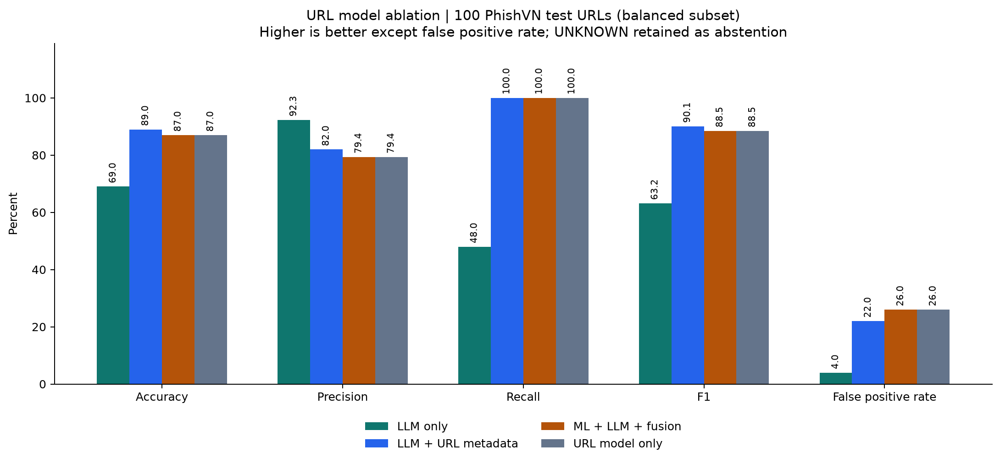
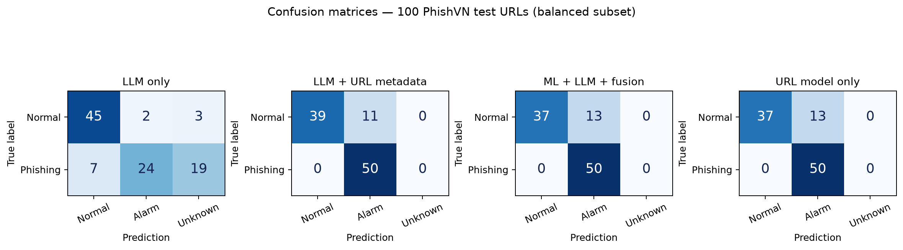

# Đánh giá đúng tập URL PhishVN

## Dữ liệu và xác minh nguồn

Dùng PhishVN V4 (gói `PhishVN_v3.1.0_open.zip`), tác giả Thai Nguyen Vu, giấy phép dữ liệu **CC BY 4.0**, DOI [10.17632/b97hxbxtpd.4](https://data.mendeley.com/datasets/b97hxbxtpd/4). Giữ nguyên split theo registrable domain và thời gian do nguồn cung cấp; không lấy ngẫu nhiên từ toàn bộ dữ liệu rồi chia lại. Bộ dữ liệu theo ngữ cảnh Việt Nam gồm cả tên miền quốc tế, không lọc riêng hậu tố `.vn`.

Archive có SHA-256 `308351e9d0c0fca13a81f2f63524a7dee08ccba6c775848d125b3da5525d0ab5`, khớp notebook `Train_URL_Phishing_GPU.ipynb`. Cả ba file split khớp MANIFEST. Sau đúng bước chuẩn hóa/khử trùng của notebook, không có mẫu lỗi hoặc trùng cần loại. Đã kiểm tra không giao nhau giữa train/val/test theo ID, model_input và domain_group.

| Split | Tổng URL | Benign | Phishing |
|---|---:|---:|---:|
| Train | 36.909 | 11.004 | 25.905 |
| Validation | 7.266 | 1.561 | 5.705 |
| Test | 8.941 | 3.845 | 5.096 |

Mã sinh feature và preprocessing xuất kèm model khớp từng byte với chuỗi nguồn trong notebook. Khôi phục được fingerprint **`d3d1ee19f42b`**, khớp config model. Chạy lại validation tái lập chính xác TP/FP/TN/FN đã lưu, ở cả ngưỡng WARNING và 0,5. Đây là bằng chứng kiểm tra đúng dữ liệu, pipeline và lượt model; không chỉ suy đoán từ tên file ZIP.

Không huấn luyện lại hoặc chỉnh ngưỡng trong lượt này. Cả ML và LLM đều phân tích chuỗi URL, không truy cập trang đích.

## Ngưỡng thực sự được chọn thế nào?

Đã tìm được notebook gốc trong thư mục BCTT. Hàm `choose_thresholds` dùng **validation**:

- WARNING: chọn điểm tối đa hóa F2 trong các ngưỡng có Precision ≥ 0,80. Nếu nhiều ngưỡng bằng F2 thì chọn ngưỡng gần 0,5 nhất. Kết quả: **0,11384317278862**.
- HIGH: trong các ngưỡng ≥ WARNING, có Precision ≥ 0,95 và ít nhất 30 mẫu bị cảnh báo, chọn ngưỡng có Recall cao nhất; tiếp theo ưu tiên Precision và ngưỡng thấp hơn. Kết quả: **0,47364333271980286**.
- Model được chọn theo F2 trên validation, có phạt nếu không đạt ràng buộc Precision của WARNING. Không chọn lại dựa trên test.

F2 nhấn mạnh Recall, vì vậy WARNING chủ động chấp nhận nhiều cảnh báo nhầm hơn để giảm bỏ sót. Tại HIGH, Precision validation là 95,02%, đạt điều kiện đặt ra; đây không phải cam kết Precision của mọi tập dữ liệu mới.

## Model URL trên toàn bộ 8.941 URL test

| Ngưỡng | Accuracy | Precision | Recall | F1 | FPR | TP / FP / TN / FN |
|---|---:|---:|---:|---:|---:|---|
| WARNING ≥ 0,113843 | 87,07% | 81,83% | 99,39% | 89,76% | 29,26% | 5.065 / 1.125 / 2.720 / 31 |
| HIGH ≥ 0,473643 | 86,15% | 93,70% | 81,16% | 86,98% | 7,23% | 4.136 / 278 / 3.567 / 960 |
| Mốc 0,5 có sẵn trong notebook | 85,01% | 94,84% | 77,94% | 85,57% | 5,62% | 3.972 / 216 / 3.629 / 1.124 |

ROC-AUC = **0,96549**; Average Precision = **0,97212**. Ba ngưỡng trên đã có trong gói model/notebook trước lượt chạy; không chọn ngưỡng tốt nhất trên test. Nếu dùng HIGH làm điểm phân loại dương thì WARNING được tính là âm trong hàng HIGH; ứng dụng hiện vẫn hiển thị WARNING như một cảnh báo.

Model đạt Recall cao tại WARNING, với đánh đổi rõ về FPR. Cảnh báo nhầm có khác biệt lớn giữa các nguồn benign:

| Nguồn benign | Số URL | FP tại WARNING | FPR |
|---|---:|---:|---:|
| `tinnhiem_org` | 358 | 27 | 7,54% |
| `tinnhiem_web` | 2.246 | 127 | 5,65% |
| `tranco` | 888 | 776 | 87,39% |
| `tranco_vn` | 353 | 195 | 55,24% |

Riêng phần gold/silver của test có 4.332 URL (487 phishing, 3.845 benign). Tại WARNING, Recall = 98,97% nhưng Precision = **29,99%**, F1 = **46,04%**. Tập đầy đủ có thêm nhiều mẫu phishing bronze, nên Precision/F1 cao hơn. Phải báo cả thành phần lớp và tier, không coi kết quả toàn bộ là đại diện riêng cho dữ liệu đã xác minh.

Kết quả này thay thế việc dùng số đo trên 60 thông điệp mô phỏng để suy luận chất lượng model URL. [Bộ 60 thông điệp](SYNTHETIC.md) được giữ cho mục đích kiểm tra ngữ cảnh và logic fusion.

## So sánh có và không có model URL trên cùng URL test

Lấy cố định 100 URL từ split test: 50 benign, 50 phishing, seed `20261026`. Chọn theo nhãn/ID bằng thuật toán cố định trước khi dự đoán, không chọn theo điểm hoặc độ đúng của ML. Lưu toàn bộ ID được chọn để kiểm tra lại. Vì lấy cân bằng lớp, Precision/Accuracy của tập 100 không thể thay trực tiếp cho Precision/Accuracy trên toàn bộ test có tỷ lệ lớp khác.

LLM đọc chính URL với `mode=url`, không tạo email giả rồi gán nhãn email theo nhãn URL. Nhánh độc lập không nhận điểm ML và không dùng ML trong quyết định của nó; nhánh còn lại nhận thêm đúng score/ngưỡng ML. Giữ prompt `baseline-1.0`, model `DeepSeek-V4-Flash`, temperature 0,1, tối đa 4.096 token, timeout 90 giây. Hai nhánh cùng nhận URL đã qua cùng quy tắc che dữ liệu. Chỉ gửi URL và metadata cần thiết, không gửi nhãn, source, tier hoặc ID dataset cho LLM.

Kết quả số đo của năm cấu hình, coverage, lỗi API và thống kê theo cặp được lưu trong [summary.json](../../artifacts/evaluations/phishvn_official_v1/summary.json). Bảng từng URL và từng quyết định ở [comparison.csv](../../artifacts/evaluations/phishvn_official_v1/comparison.csv), phản hồi đầy đủ ở [results.jsonl](../../artifacts/evaluations/phishvn_official_v1/results.jsonl). Không tự retry hoặc thay phản hồi lỗi bằng một lần gọi thuận lợi hơn.

Đã hoàn tất **200/200 phản hồi hợp lệ**, không có lỗi API/JSON. Mỗi nhánh chạy một lần trên mỗi URL. Nhãn HIGH/WARNING là dự đoán dương, LOW là âm, UNKNOWN là abstain. Accuracy dùng toàn bộ 100 mẫu; Recall và F1 giữ mẫu dương UNKNOWN trong mẫu số, thay vì chỉ chấm trên các mẫu LLM chịu trả lời. Vì vậy cần đọc cùng coverage và số UNKNOWN.

| Cấu hình, cùng 100 URL | Accuracy toàn bộ | Precision | Recall toàn bộ | F1 toàn bộ | FPR | Coverage | TP / FP / TN / FN | UNKNOWN (+/-) |
|---|---:|---:|---:|---:|---:|---:|---|---|
| Chỉ model URL, WARNING là dương | 87% | 79,37% | 100% | 88,50% | 26% | 100% | 50 / 13 / 37 / 0 | 0 / 0 |
| LLM không nhận điểm URL | 69% | 92,31% | 48% | 63,16% | 4% | 78% | 24 / 2 / 45 / 7 | 19 / 3 |
| LLM nhận điểm URL, trước fusion | 89% | 81,97% | 100% | 90,09% | 22% | 100% | 50 / 11 / 39 / 0 | 0 / 0 |
| Model URL + LLM độc lập + fusion | 87% | 79,37% | 100% | 88,50% | 26% | 100% | 50 / 13 / 37 / 0 | 0 / 0 |
| Model URL + LLM nhận điểm URL + fusion | 87% | 79,37% | 100% | 88,50% | 26% | 100% | 50 / 13 / 37 / 0 | 0 / 0 |





**Nhận định sau khi dùng đúng loại test:** model URL giúp LLM đưa ra được kết luận trên các URL mà LLM độc lập thiếu căn cứ. Thêm metadata sửa đúng 26 mẫu so với baseline, làm sai thêm 6 mẫu; Accuracy tăng 20 điểm phần trăm. Baseline có 22 UNKNOWN (19 phishing, 3 benign), nên F1 thấp không chỉ là phân loại nhầm: một phần lớn là từ chối kết luận. Trên 78 mẫu baseline có kết luận, selective accuracy là 88,46%; chỉ số này không thay thế Accuracy trên toàn bộ test. Việc giảm abstain cần được cân nhắc cùng sự tăng FPR từ 4% lên 22%.

LLM có metadata sửa được hai cảnh báo nhầm của model URL trên tập 100 (FP 13 xuống 11). Tuy nhiên, fusion hiện tại đưa hai mẫu đó trở lại cảnh báo, nên F1 đầu ra cuối là 88,50%, thấp hơn F1 90,09% của riêng nhận định LLM đã nhận metadata. Quy tắc giữ cảnh báo ML vẫn có đánh đổi, dù model hữu ích hơn rõ rệt trên đúng tác vụ URL.

Kết quả này không chứng minh mô hình kết hợp luôn tốt hơn LLM trong email/tin nhắn thực tế. Nó là phép thử URL-only trên một mẫu test cân bằng, có 100 URL và một lượt LLM mỗi nhánh. Dữ liệu PhishVN có nhiều tier; các số đo nhạy với tỷ lệ lớp và nguồn. Nên mở rộng mẫu theo tier/source và lặp LLM trước khi đưa ra kết luận tổng quát. Phần lớn model recall cao trên tập 100 cũng đã có ở baseline ML đơn thuần.

## Kiểm chứng và giới hạn báo cáo trước

Các số đo năm cấu hình được đối chiếu độc lập bằng scikit-learn với 200 checkpoint duy nhất. Bộ unit test hiện đạt **50/50**, gồm kiểm tra archive/manifest, chống trùng domain giữa các split, ánh xạ nhãn, fingerprint, và baseline LLM không bị fusion ML ảnh hưởng. [independent_metric_check.json](../../artifacts/evaluations/phishvn_official_v1/independent_metric_check.json) lưu hash của kết quả đã kiểm chứng.

Bộ 60 thông điệp mô phỏng trước đó gán nhãn hành vi trong tin nhắn, có các URL chỉ để minh họa. FPR 96,67% ở báo cáo đó là cảnh báo trong các thông điệp nhãn benign, không phải FPR URL trên PhishVN. Trên tập URL đúng nguồn, FPR tại WARNING là 29,26%, tại HIGH là 7,23%. Hai phép đo có nhiệm vụ và ground truth khác nhau; kết luận model URL kém dựa riêng trên 60 thông điệp là diễn giải quá rộng.

## Tái lập

Đặt gói model như README ứng dụng, tải đúng archive từ DOI, cung cấp notebook huấn luyện gốc và cấu hình FPT_API_KEY trong `.env` nếu chạy LLM. Giấy phép CC BY 4.0 áp dụng cho dữ liệu và các URL/nhãn được trích trong các CSV kết quả; ghi công Thai Nguyen Vu và nguồn DOI khi phân phối lại.

Chạy toàn bộ ML, kiểm tra nguồn và chuẩn bị mẫu 100 URL, không gọi FPT:

```bash
.venv/bin/python -m evaluation.phishvn \
  --archive data/raw/PhishVN_v3.1.0_open.zip \
  --notebook notebooks/Train_URL_Phishing_GPU.ipynb \
  --out artifacts/evaluations/phishvn_offline_v1
```

Chạy phép so sánh LLM thật: thêm `--live`, dùng thư mục `--out` mới cho cấu hình mới. Tối đa 200 lần gọi mới cho 100 URL, hai lượt đồng thời; chạy lại đúng cấu hình và cùng thư mục sẽ dùng checkpoint đã có. Kết quả lần chạy đã bàn giao nằm ở `artifacts/evaluations/phishvn_official_v1`.

```bash
.venv/bin/python -m evaluation.phishvn \
  --archive data/raw/PhishVN_v3.1.0_open.zip \
  --notebook notebooks/Train_URL_Phishing_GPU.ipynb \
  --out artifacts/evaluations/phishvn_new --live
.venv/bin/python scripts/evaluation/verify_evaluation.py artifacts/evaluations/phishvn_new
.venv/bin/python scripts/evaluation/plot_evaluation.py artifacts/evaluations/phishvn_new
```

`provenance.json` lưu kiểm tra archive, split và fingerprint. `url_model_metrics.json` lưu kết quả toàn bộ validation/test và theo tier/source; `val_predictions.csv`/`test_predictions.csv` lưu từng điểm. `selected_ids.csv` và manifest khóa mẫu so sánh LLM. Script đọc hằng số notebook bằng AST, không thực thi notebook, không cài GPU, không train và không mở các URL trong dataset.
