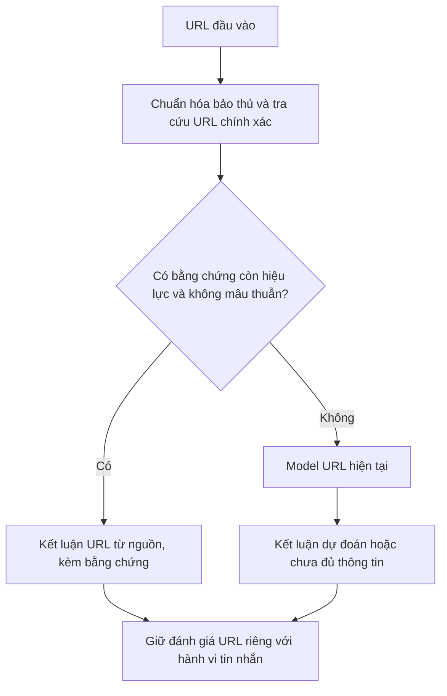

# Thử nghiệm kho uy tín URL trước model

Ngày: **04/11/2026**. Đã triển khai và chạy prototype cục bộ. **Tra cứu giúp bỏ qua model với URL có bằng chứng còn hiệu lực; chưa cải thiện nhận diện URL chưa biết.** Thành phần này chưa được bật trong ứng dụng mặc định.

## Luồng đã thử



- [url_reputation.py](../../app/url_reputation.py) cung cấp kho bằng chứng và hàm chuyển tuyến `route_urls`. Chỉ URL chưa được giải quyết bởi tra cứu mới đi vào model; giữ thứ tự đầu vào và kiểm tra URL trả về.
- Bản ghi có URL, nguồn, ID nguồn, tier, loại bằng chứng, thời điểm có bằng chứng và hết hạn. Phân biệt `known`, `miss`, `expired`, `not_yet_valid`, `conflict`, `invalid_url`.
- Chỉ khớp URL chính xác sau chuẩn hóa host/IDNA, cổng mặc định và path gốc. Giữ khác biệt scheme, path, query và fragment; URL không ghi scheme có không gian khóa riêng. Không mở trang đích, theo redirect hoặc suy rộng uy tín sang miền con/path khác.
- Chưa hỗ trợ bản ghi áp dụng cho toàn bộ host/tên miền; cần thiết kế phạm vi bằng chứng trước khi thêm. Bản ghi root URL không tự bao phủ mọi trang của website đó.
- Dự đoán model, ý kiến LLM và độ phổ biến không được dùng làm loại bằng chứng uy tín. Hàm chuyển tuyến không ghi kết quả ML ngược vào kho, không tự gia hạn bằng chứng.
- Lỗi model vẫn là UNKNOWN. URL uy tín không xác nhận tin nhắn xin OTP là an toàn; phân tích hành vi vẫn là nhiệm vụ riêng.

Mô hình tra cứu kèm thời hạn có tham khảo cách Safe Browsing quy định `cacheDuration`. Các TTL dưới đây là giả định thử nghiệm riêng, không lấy từ dịch vụ này. [Tài liệu Google](https://developers.google.com/safe-browsing/reference/rest/v5/urls/search).

## Kho dữ liệu và tính công bằng

Kho gồm **7.094 bản ghi từ split train chính thức của PhishVN**, được dựng trước khi đọc nhóm dev và không dùng điểm model để chọn mẫu:

| Loại bản ghi | Số lượng | Nguồn |
|---|---:|---|
| Uy tín theo nhãn nguồn | 5.018 | Tín nhiệm tổ chức/website, gold |
| Rủi ro theo nhãn nguồn | 2.076 | Tín nhiệm mạng, gold/silver |

Loại 3 bản ghi có URL/thời gian không phù hợp với quy tắc thử nghiệm và 29.812 bản ghi ngoài nguồn/tier/nhãn được phép. Không dùng Tranco làm bằng chứng uy tín, không dùng bronze trong kho này. PhishVN có giấy phép CC BY 4.0; [nguồn dữ liệu](https://data.mendeley.com/datasets/b97hxbxtpd/4), [giấy phép đi kèm](../../data/annotation/url_context_v1/DATA_LICENSE.txt).

Nhãn là nhãn lịch sử, chưa được dự án xác minh lại website hiện tại. Nhãn dương có thể bao gồm lạm dụng ngoài credential phishing. Việc kiểm tra schema/nguồn không chứng minh mọi nhãn đều đúng.

Hai nhóm yêu cầu được báo riêng:

1. **40 URL chưa biết:** giữ nguyên 40 URL dev của bộ URL/ngữ cảnh trước, 20 dương/20 âm, khác tên miền với toàn bộ train. Không có URL/miền nào từ nhóm này vào kho. Đây là nhóm chẩn đoán chất lượng trên URL chưa biết, nhưng dev đã được xem trước đây, không phải test độc lập mới.
2. **200 truy cập lại:** lấy từ các bản ghi của kho bằng hash/seed cố định, một URL mỗi miền, 100 dương/100 âm. Nhóm này **cố ý trùng kho và dữ liệu ML đã học**, chỉ kiểm tra khả năng chuyển tuyến. Nhãn chấm chính là nhãn nguồn đã nạp, nên điểm tra cứu 100% là kết quả được kỳ vọng theo thiết kế; không chứng minh khả năng tổng quát hoặc độ đúng độc lập của kho.

Hỗn hợp 200 đã biết + 40 chưa biết là tỷ lệ lưu lượng do thí nghiệm đặt ra. Không gọi đây là tập test thực tế và không dùng F1 tổng để khẳng định hiệu quả ngoài mẫu.

## Điều kiện chạy

Đã khóa `execution.json`, hash kho, yêu cầu, mã nguồn, gói model và ngưỡng **trước suy luận**. Giữ WARNING **0,11384317278862**, HIGH **0,47364333271980286**; không chọn lại ngưỡng, seed hoặc mẫu sau kết quả.

TTL cố định trước suy luận: bản ghi rủi ro **7 ngày**, uy tín **30 ngày**. Dùng `scraped_at` làm thời điểm có snapshot, ngày không ghi giờ được coi là 00:00 UTC. **Đây là giả định mô phỏng thời điểm có dữ liệu, không xác nhận website được kiểm tra lại vào ngày scrape.** TTL chưa được hiệu chỉnh cho triển khai thực tế.

Chạy hai mốc thời gian trên cùng yêu cầu và model:

- Snapshot lịch sử: **16/07/2026, 11:03:48 UTC**, ngay sau bản ghi train cuối; bằng chứng cho 200 URL truy cập lại còn hiệu lực.
- Kiểm tra hết hạn: **04/11/2026, 00:00 UTC**; giữ nguyên snapshot, không tải nguồn mới hoặc gia hạn bằng dự đoán model.

Không gọi LLM/RAG/API, không mở URL được kiểm tra, không chạy phần test URL/ngữ cảnh. Đã thực sự đưa **520 đầu vào URL qua model**: 240 cho baseline, 40 cho cấu hình kết hợp ở mốc lịch sử và 240 ở mốc hết hạn. Đây là số lượt suy luận trong thí nghiệm; chỉ có 240 URL yêu cầu khác nhau.

## Kết quả

Tại mốc lịch sử còn hiệu lực:

| Nhóm | F1: model → tra cứu + model | FPR: model → kết hợp | URL phải qua model: trước → sau |
|---|---:|---:|---:|
| Truy cập lại 200 URL có trong kho — đối chứng | 84,72% → 100%* | 32% → 0%* | 200 → 0 |
| 40 URL dev chưa biết — nhóm chẩn đoán chính | 72,73% → **72,73%** | 75% → **75%** | 40 → 40 |
| Hỗn hợp thiết kế 240 yêu cầu | 82,39% → 94,12%* | 39,17% → 12,50%* | 240 → 40 |

\* Lợi ích tra cứu theo cùng nhãn nguồn đã có trong kho; không phải mức cải thiện dự đoán trên dữ liệu độc lập.

Trên nhóm chưa biết, model vẫn cảnh báo nhầm **15/20 URL âm**; lớp tra cứu không sửa được ca nào vì không có hit. Trên nhóm truy cập lại, thay dự đoán ML bằng nhãn nguồn sửa 32 cảnh báo nhầm và 3 ca bỏ sót, theo đúng nhãn nguồn của kho. Không được đọc các ca này như được người chấm độc lập xác nhận.

Hỗn hợp thiết kế bỏ qua model ở **83,33% yêu cầu**, đúng bằng tỷ lệ 200/240 có trong kho. Đây là chỉ số vận hành của lưu lượng giả định, không phải tỷ lệ tiết kiệm thực tế đã đo ở người dùng. Chưa đo mức tăng tốc hay chi phí ứng dụng đầu cuối.

Chỉ tra cứu có coverage **0%** trên 40 URL mới và **83,33%** trên hỗn hợp; FPR bằng 0 trên nhóm chưa biết chỉ vì không đưa ra cảnh báo nào, không có nghĩa phân loại đúng các URL đó. Cấu hình kết hợp có coverage 100% trong lượt này.

Tại mốc 04/11, **200 bản ghi khớp đều hết hạn**, còn 40 URL là miss. Toàn bộ 240 yêu cầu phải quay về model; F1 hỗn hợp trở về **82,39%**, FPR **39,17%**, tỷ lệ bỏ qua model **0%**. Snapshot hiện tại vì thế chưa phù hợp để bật như kho uy tín còn hiệu lực trong ứng dụng.

## Đánh giá và bước tiếp theo

Thử nghiệm xác nhận cách chuyển tuyến hoạt động và cho thấy hai công việc cần làm đồng thời:

1. Muốn giảm gọi model trên URL đã biết, cần nguồn bằng chứng mới, phạm vi rõ ràng và cơ chế cập nhật/hết hạn. Kho lớn nhưng cũ không đem lại lợi ích khi áp dụng thời hạn đúng.
2. Muốn cải thiện URL chưa biết, vẫn cần rà đặc trưng/model và ngưỡng trên dữ liệu phát triển phù hợp. Bổ sung kho không giải quyết mức báo nhầm 75% của nhóm dev này.

Trước khi triển khai, cần đo coverage của kho cập nhật trên một luồng yêu cầu mới, kiểm tra chéo nhãn nguồn, so sánh các cấu hình trên cùng thời điểm và giữ riêng kết quả URL chưa biết. Không nạp nhãn test vào kho rồi dùng lại tập đó để tuyên bố chất lượng phát hiện tăng.

## Tái lập và tệp kết quả

```bash
# Chuẩn bị kho và khóa cấu hình; chọn một thư mục mới.
.venv/bin/python -m evaluation.reputation prepare \
  --out artifacts/evaluations/reputation_dev_rebuild \
  --reevaluate-at 2026-11-04T00:00:00+00:00

# Chạy suy luận URL cục bộ theo cấu hình đã khóa; không gọi LLM.
.venv/bin/python -m evaluation.reputation run \
  --out artifacts/evaluations/reputation_dev_rebuild
```

- [Báo cáo đầy đủ ba cấu hình và hai mốc thời gian](../../artifacts/evaluations/reputation_dev_v1/report.md).
- [Summary và biên bản kiểm chứng](../../artifacts/evaluations/reputation_dev_v1/summary.json), [cấu hình khóa trước chạy](../../artifacts/evaluations/reputation_dev_v1/execution.json).
- [Kho bằng chứng](../../artifacts/evaluations/reputation_dev_v1/knowledge.jsonl), [các yêu cầu và nhóm](../../artifacts/evaluations/reputation_dev_v1/requests.jsonl), [trace gọi model](../../artifacts/evaluations/reputation_dev_v1/calls.jsonl).

Artifacts là kết quả cục bộ, không tự đi kèm bản clone Git. Các số liệu và giới hạn chính đã được giữ trong tài liệu này. P/R/F1 đã được đối chiếu scikit-learn; trace kiểm tra model chỉ nhận URL chưa được tra cứu giải quyết. Kiểm thử chức năng bao gồm giả dạng hostname, thay path/query/fragment, hết hạn, bằng chứng tương lai/mâu thuẫn, lỗi model và không ghi dự đoán ngược vào kho.
