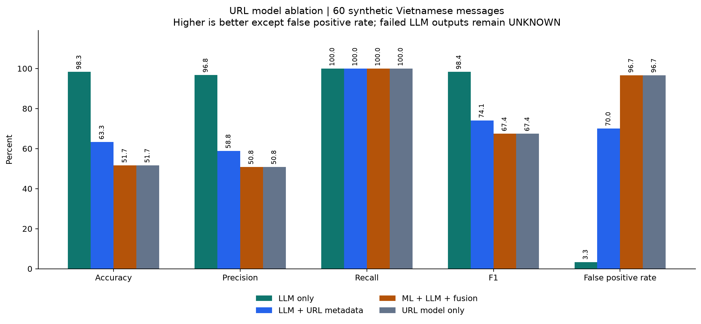
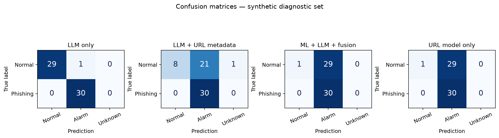

# Kết quả so sánh có và không có model URL

**Phạm vi: báo cáo này chỉ là kiểm thử ngữ cảnh trên dữ liệu mô phỏng. Đánh giá model URL trên tập test PhishVN chính thức và so sánh LLM trên cùng URL được trình bày trong [PHISHVN_EVALUATION.md](PHISHVN.md). Không dùng bảng 60 thông điệp dưới đây thay cho số đo chất lượng bộ phân loại URL.**

Ngày 26/10/2026, chạy thật với `DeepSeek-V4-Flash` qua FPT và trọng số `XGBoost_d6_s42`. **Trên bộ chẩn đoán này, bổ sung model URL làm giảm chất lượng nhận diện thông điệp vì tăng cảnh báo nhầm; chưa quan sát được lợi ích về recall.** Đây là kết luận cho 60 mẫu mô phỏng được tự gán nhãn, chưa chứng minh chất lượng trên dữ liệu thực tế.

## Dữ liệu và thiết kế

60 email/tin nhắn tiếng Việt, mỗi mẫu có một URL; 30 phishing và 30 thông thường. Sáu nhóm tình huống có số mẫu cân bằng: ngân hàng, giao hàng, công việc, mua sắm, cơ quan nhà nước, ngữ cảnh/prompt injection. Nhãn được viết trước khi chạy và không gửi cho LLM. Sáu cặp kiểm soát dùng cùng URL với ngữ cảnh đối lập.

Hai cấu hình LLM nhận cùng văn bản đã che dữ liệu và system prompt `baseline-1.0`; khác nhau ở việc có nhận thêm metadata model URL. Temperature 0.1, `top_p=1`, `top_k=40`, tối đa 4.096 token, timeout 90 giây, hai worker. Không chỉnh ngưỡng ML: WARNING = 0.11384317278862; HIGH = 0.47364333271980286. Không thay prompt hoặc huấn luyện lại model trong thí nghiệm.

Đã hoàn tất 120 lần gọi API: 60/60 phản hồi hợp lệ ở nhánh không có metadata; 59/60 ở nhánh có metadata. Mẫu N09 của nhánh có metadata bị `OUTPUT_INVALID`, giữ nguyên là UNKNOWN. Không gọi lại để thay kết quả lỗi. Trước lượt chính có pilot giới hạn 1.536 token, ghi nhận 45 phản hồi và hai request đang xử lý bị hủy khi dừng; pilot có phản hồi bị cắt, được giữ riêng và không trộn vào số đo dưới đây.

## Số đo chính

HIGH/WARNING đều tính là cảnh báo dương; LOW là âm. Accuracy dùng toàn bộ 60 mẫu; lỗi/UNKNOWN không được tính là dự đoán đúng. Recall và F1 giữ mẫu dương UNKNOWN trong mẫu số; UNKNOWN âm không được coi là TN. Vì nhánh có metadata có một UNKNOWN âm, cần đọc FPR cùng coverage.

| Cấu hình | Accuracy | Precision | Recall | F1 | FPR | TP / FP / TN / FN | UNKNOWN |
|---|---:|---:|---:|---:|---:|---|---:|
| LLM, không nhận model URL | 98,33% | 96,77% | 100% | 98,36% | 3,33% | 30 / 1 / 29 / 0 | 0 |
| LLM nhận metadata model URL, trước fusion | 63,33% | 58,82% | 100% | 74,07% | 70,00% | 30 / 21 / 8 / 0 | 1 |
| Model URL + LLM độc lập + fusion | 51,67% | 50,85% | 100% | 67,42% | 96,67% | 30 / 29 / 1 / 0 | 0 |
| Model URL + LLM nhận metadata + fusion | 51,67% | 50,85% | 100% | 67,42% | 96,67% | 30 / 29 / 1 / 0 | 0 |
| Chỉ lấy mức cao nhất từ model URL | 51,67% | 50,85% | 100% | 67,42% | 96,67% | 30 / 29 / 1 / 0 | 0 |

Coverage nhánh LLM có metadata là 98,33%; các cấu hình còn lại 100%. Coverage 100% của fusion phản ánh khả năng dùng lại ML khi LLM lỗi, không có nghĩa mọi phản hồi LLM đều hợp lệ.





## Điều gì làm kết quả giảm?

**Điểm URL ảnh hưởng đến nhận định LLM.** So với LLM không nhận model URL, thêm metadata không sửa đúng mẫu nào, làm 21 mẫu từ đúng thành sai/UNKNOWN: 20 cảnh báo nhầm mới và một phản hồi lỗi. Accuracy giảm 35 điểm phần trăm. Nếu chỉ xét 59 mẫu có cả hai phản hồi hợp lệ, vẫn có 20 mẫu bị làm sai thêm và không có mẫu được sửa đúng; kết quả không chỉ do một lỗi JSON.

Ví dụ N01 chỉ chia sẻ tài liệu lập ngân sách. LLM độc lập trả LOW; khi nhận điểm URL, nó trả HIGH và giải thích rằng văn bản có vẻ thông thường nhưng URL được mô hình phân loại rủi ro cao. Đây là dấu hiệu LLM dựa quá mạnh vào metadata ML trong lượt này.

**Quy tắc fusion giữ mọi cảnh báo HIGH của ML.** Model URL đánh giá 59/60 URL là HIGH, trong đó có 29/30 mẫu thông thường. Fusion luôn giữ HIGH này kể cả LLM nhận diện đúng ngữ cảnh thông thường. So với LLM độc lập, hệ thống đầy đủ không sửa đúng mẫu nào và làm sai thêm 28 mẫu; Accuracy giảm 46,67 điểm phần trăm.

N26 là bài học cảnh báo người đọc không làm theo câu xin OTP; N29 chỉ minh họa URL dạng phishing trong slide và yêu cầu không mở URL. Cả hai nhánh LLM đều trả LOW, nhưng kết quả cuối vẫn HIGH do ML. Vì vậy, chỉ tắt cung cấp điểm ML cho LLM chưa loại bỏ ảnh hưởng của model URL khỏi kết quả ứng dụng.

LLM độc lập cũng có lỗi: N13 là hướng dẫn phỏng vấn, nêu công ty không thu phí tuyển dụng; LLM trả WARNING, nghi ngờ miền ví dụ và câu không thu phí. Nhận định này được tính là một cảnh báo nhầm, không loại khỏi báo cáo.

Loại 12 mẫu thuộc sáu cặp kiểm soát, trên 48 mẫu còn lại Accuracy lần lượt là 97,92% cho LLM độc lập, 64,58% cho LLM nhận metadata và 52,08% cho hệ thống đầy đủ. Xu hướng giảm không chỉ nằm ở các cặp dùng chung URL.

## Thời gian và token

Trên **59 mẫu có hai phản hồi hợp lệ**, tổng token do FPT báo là 85.651 cho LLM độc lập và 115.907 cho LLM nhận metadata: tăng khoảng 35,32%. Trung vị thời gian tương ứng 1,99 giây và 2,95 giây. Đây là thời gian gọi LLM, không phải benchmark tải của ứng dụng.

Toàn bộ lượt chính ghi nhận 86.962 token ở nhánh độc lập và 115.907 ở nhánh có metadata. Lượt phản hồi sai JSON không được service trả lại usage, nên số token ghi nhận chưa bao gồm usage của request đó và không phải tổng hóa đơn. Pilot được lưu riêng.

## Giới hạn và hướng tiếp theo

Nhãn do một bên tự soạn, nhiều mẫu có dấu hiệu lừa đảo rõ ràng; nhiều URL dùng miền ví dụ, khác phân phối huấn luyện của model URL. Các cặp kiểm soát có phụ thuộc nhau. LLM chỉ chạy một lần mỗi cấu hình và có thể dao động dù temperature thấp. McNemar theo cặp được lưu trong báo cáo máy, nhưng với thiết kế mô phỏng này chỉ có ý nghĩa thăm dò. Không nên dùng các số đo này để tuyên bố LLM đạt 98,33% ngoài thực tế hoặc model URL chỉ đạt 51,67% trên tập URL chuẩn.

Ưu tiên tiếp theo là kiểm tra model URL trên tập URL độc lập có nhãn thật, kiểm tra sự khớp feature với huấn luyện, và chọn ngưỡng trên validation phù hợp. Với thông điệp, cần cân nhắc hiển thị riêng rủi ro URL và rủi ro hành vi, rồi thử quy tắc kết hợp thay vì luôn ép kết quả cuối thành HIGH. Mọi thay đổi prompt/ngưỡng/fusion nên được đánh giá trên tập khác; tập 60 mẫu này giữ làm bộ hồi quy chẩn đoán.

## Tệp và cách kiểm chứng

- [Dữ liệu và nhãn](../../data/evaluation/vietnamese_messages_v1.jsonl), [phương pháp và lệnh chạy](METHODS.md).
- [Kết quả từng mẫu CSV](../../artifacts/evaluations/url_model_ablation_v1/comparison.csv), [đầu ra chi tiết JSONL](../../artifacts/evaluations/url_model_ablation_v1/results.jsonl).
- [Số đo JSON](../../artifacts/evaluations/url_model_ablation_v1/summary.json), [manifest và hash](../../artifacts/evaluations/url_model_ablation_v1/manifest.json), [báo cáo tự sinh](../../artifacts/evaluations/url_model_ablation_v1/report.md).
- [Đối chiếu số đo bằng scikit-learn](../../artifacts/evaluations/url_model_ablation_v1/independent_metric_check.json).

Mã kiểm thử đạt **43/43 test**: gồm 31 test có sẵn và 12 test mới cho dữ liệu, số đo, baseline độc lập, chống rò nhãn, checkpoint, giới hạn số lần gọi và dừng khi lỗi tài khoản. Các unit test mô phỏng HTTP; 120 lần gọi trong báo cáo là FPT thật. Script đối chiếu độc lập xác nhận số đo của năm cấu hình và tính nhất quán của 120 checkpoint, không gọi thêm API.

```bash
.venv/bin/python -m pytest -q
.venv/bin/python scripts/evaluation/verify_evaluation.py artifacts/evaluations/url_model_ablation_v1
.venv/bin/python scripts/evaluation/plot_evaluation.py artifacts/evaluations/url_model_ablation_v1
```
